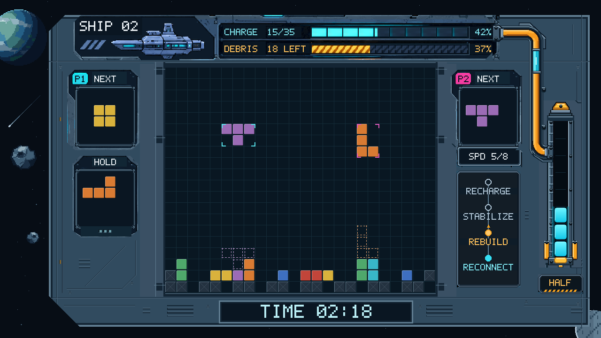

# 芯际救援：俄罗斯方块游戏机

一台以飞船维修为主题的 FPGA 俄罗斯方块游戏机。独自恢复飞船供能，或与另一名玩家在同一场地协作清障；从方块落定到核心启动，游戏逻辑、画面和声音都由 FPGA 完成。

支持 **四种游戏模式 · HDMI 音视频输出 · 以太网音视频传输 · 双人按键控制**。

[快速开始](#快速开始) · [操作方式](#操作方式) · [工程结构](#工程结构) · [技术文档](#技术文档)

## 游戏特色

- **双人共享场地**：两名玩家各有 NEXT，共享堆叠区域与 HOLD，在同一艘飞船上配合消行。
- **消行就是维修**：闯关中清除残骸、累积充能，推动核心从 LOCKED、HALF 到 ONLINE；残骸全部清除后，缠绕核心的锁链才会解除。
- **带供能压力的无尽模式**：持续消行补充储备，随着游玩时间推进速度提高；顶出或供能耗尽即结束。
- **完整的游玩辅助**：七种方块、旋转、暂存、落点虚影和单人智能落点，配合机械像素风界面、音效、配乐与语音反馈。
- **两种游玩连接方式**：通过 HDMI 接显示器并用外接按键操作，或通过网线在 Windows 电脑上接收画面、播放声音并使用键盘控制。

## 游戏模式

| 模式 | 场地 | 目标 |
| --- | --- | --- |
| 单人闯关 | 20 × 20 | 挑战四艘飞船，清除残骸并完成充能目标 |
| 双人闯关 | 24 × 20 | 两人协作清障、充能，共享核心与结算 |
| 单人无尽 | 20 × 20 | 消行补充储备，应对逐渐提高的速度 |
| 双人无尽 | 24 × 20 | 在共享场地内配合，尽可能延长航行时间 |

单人模式提供图形化智能落点提示，双人模式保留完整的 P2 NEXT。详细计分、HOLD 冷却、提示额度和胜负条件见[玩法规格](docs/游戏模式_玩法规格.md)。

## 快速开始

### 在开发板上运行

1. 使用配套板卡，核对[按键接线](docs/技术说明/双来源双人控制.md)，连接 HDMI 显示设备。
2. 使用 Vivado Hardware Manager 下载 [Tetris.bit](bit/Tetris.bit)。
3. 进入主菜单，选择单人／双人及闯关／无尽模式，开始游戏。

需要写入配置 Flash 时，使用同版本 [Tetris.bin](bit/Tetris.bin)，并按实际板卡选择 Flash 型号及启动模式。固件对应器件为 `xc7a35tfgg484-2`；移植到其他板卡时需调整引脚与时钟配置。

### 在电脑上接收画面与声音

1. 用网线连接 FPGA 与 Windows 10／11 x64 电脑的有线网卡。
2. FPGA 默认地址为 `192.168.0.2`，电脑有线网卡使用 `192.168.0.3/24`。
3. 运行 [TetrisPC.exe](TetrisPC.exe)，按提示完成必要的网卡配置；程序自带运行依赖，无须另装 Python。
4. 点击游戏窗口使其获得焦点，即可使用键盘操作；声音通过 Windows 默认音频设备播放。

PC 接收 FPGA 生成的画面与音频，游戏仍在开发板上运行。网卡配置、无板网口自测和故障排查见[PC 端说明](pc/README.md)。

## 操作方式

| 操作 | P1 | P2 |
| --- | --- | --- |
| 左／右移动 | A／D | ←／→ |
| 旋转 | W | ↑ |
| 下落 | S | ↓ |
| HOLD | Q | 小键盘 0 |

**公共按键**：Enter／小键盘 5 开始或暂停，Esc 返回，F12／小键盘 9 复位。小键盘需开启 NumLock。

下落键支持短按释放与长按加速；单人模式下，长按 HOLD 可切换智能提示。每名玩家均可使用外接按键或 PC 键盘，也可以混合使用。完整手势与引脚定义见[控制说明](docs/技术说明/双来源双人控制.md)。

## 硬件与实现

| 项目 | 配置 |
| --- | --- |
| FPGA | Xilinx Artix-7，`xc7a35tfgg484-2` |
| 开发工具 | Vivado 2018.3，Verilog／SystemVerilog |
| 显示输出 | HDMI，1280 × 720 |
| HDMI 音频 | 48 kHz、16 位、双声道 LPCM |
| 以太网交互 | RGB888 游程画面、48 kHz／16 位单声道 PCM、双人按键回传 |
| PC 客户端 | Python、NumPy、Pillow、Tk；提供 Windows 便携程序 |

当前版本已完成上板验证。整机布线使用 **19,382 LUT、7,887 个寄存器、48.5 BRAM、13 DSP**；WNS 为 **+0.097 ns**，WHS 为 **+0.032 ns**，TNS／THS 均为 0。固件指纹及验证范围见[工程说明](docs/README.md)、[实现报告](docs/reports/core_chain_20261102/README.md)和[上板记录](docs/reports/board_acceptance_20261102/README.md)。

## 工程结构

| 路径 | 内容 |
| --- | --- |
| [Tetris.xpr](Tetris.xpr) | Vivado 工程入口 |
| [Tetris.srcs/](Tetris.srcs/) | 游戏、显示、音频与网络源码，约束及 IP 配置 |
| [Tetris.sim/](Tetris.sim/) | 正式功能仿真测试台 |
| [pc/](pc/) | PC 客户端源码、打包配置与网口自测工具 |
| [assets/](assets/) | 图像、声音等原始资产与配置 |
| [tools/](tools/) | 资产生成、构建、验证和固件发布工具 |
| [bit/](bit/) | 当前配套的 `.bit` 与 `.bin` 固件 |
| [docs/](docs/) | 玩法、设计说明、参考图与验证报告 |

从源码开发时，使用支持 `.gitattributes` 编码属性的 Git 检出仓库，再用 Vivado 2018.3 打开 `Tetris.xpr`。构建步骤和依赖见[工具说明](tools/README.md)，源码编码见[编码说明](docs/技术说明/source-encoding.md)。

## 技术文档

- [模块与接口导读](docs/技术说明/模块与接口导读.md)：从游戏状态机到显示、音频与网络的数据流。
- [玩法规格](docs/游戏模式_玩法规格.md)：四种模式、关卡参数、HOLD 与智能提示规则。
- [PC 音频传输](docs/技术说明/PC音频传输.md)：音频包格式、播放缓冲与实现。
- [世界观与模式故事](docs/CORE-07_世界观与各模式故事.md)：CORE-07 维护终端与飞船救援设定。
- [工程说明](docs/README.md)：当前版本、固件指纹、启动方法与验证状态。
- [资料索引](docs/资料索引.md)：完整文档入口。

HDMI 编码与部分音频包模块使用 [hdl-util/hdmi](https://github.com/hdl-util/hdmi) 的代码；原作者声明、上游版本与 MIT／Apache-2.0 许可见[第三方来源说明](docs/技术说明/第三方来源/hdl_util_hdmi/README.md)。
