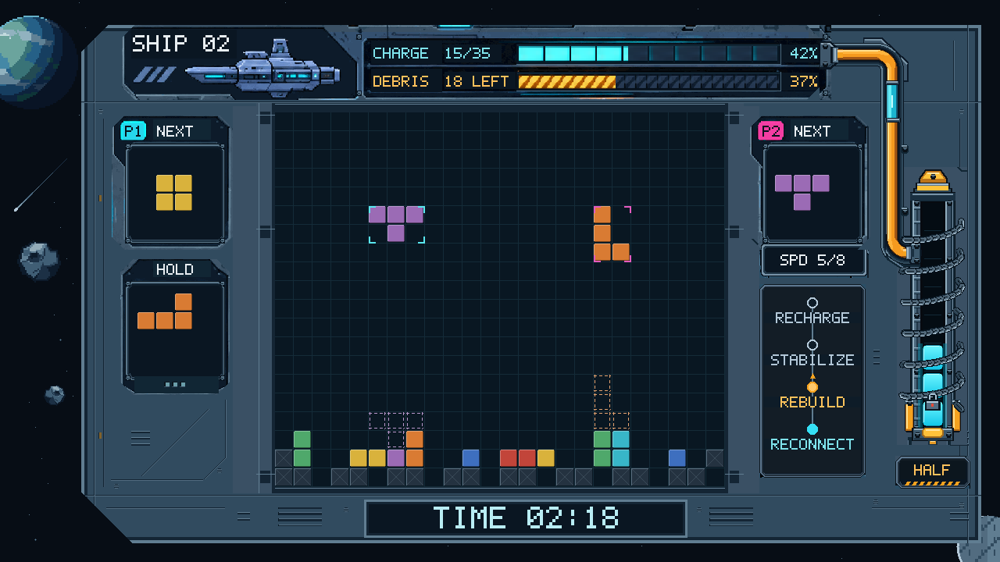

# 芯际救援：俄罗斯方块游戏机

> 固件 2026-11-02 · PC 2026.11.02.3 · 已上板验证 · Artix-7 `xc7a35tfgg484-2`／Vivado 2018.3 · [版本与技术说明](docs/README.md)

一台以飞船维修为主题的 FPGA 俄罗斯方块游戏机。独自恢复飞船供能，或与另一名玩家在同一场地协作清障；从方块落定到核心启动，游戏逻辑、画面和声音都由 FPGA 完成。

支持 **四种游戏模式 · HDMI 音视频输出 · 以太网音视频传输 · 双人按键控制**。

[快速开始](#快速开始) · [操作方式](#操作方式) · [验证与证据](#验证与证据) · [工程结构](#工程结构) · [技术文档](#技术文档)

## 游戏特色

- **核心状态可见**：LOCKED、HALF、ONLINE 对应不同电芯和警戒反馈；残骸未清空时保留六圈锁链，清空后统一解除。
- **辅助规划落点**：NEXT、HOLD 预约取出、落点虚影和单人智能落点，帮助安排当前块与后续块。
- **维修过程有声有色**：机械像素风面板、导管推进、柱内扫光，与消行音效、配乐和通信语音共同反馈游戏进程。
- **接入方式灵活**：HDMI 显示与外接按键可直接游玩；Windows 客户端支持网口画面、声音及键盘控制，两种输入可以混合使用。

## 游戏模式

| 模式 | 场地 | 目标 |
| --- | --- | --- |
| 单人闯关 `SOLO CAMPAIGN` | 20 × 20 | 挑战四艘飞船，清除残骸并完成充能目标 |
| 双人闯关 `DUO CAMPAIGN` | 24 × 20 | 两人协作清障、充能，共享核心与结算 |
| 单人无尽 `SOLO ENDLESS` | 20 × 20 | 消行补充储备，应对逐渐提高的速度 |
| 双人无尽 `DUO ENDLESS` | 24 × 20 | 在共享场地内配合，尽可能延长航行时间 |

单人模式提供图形化智能落点提示，双人模式保留完整的 P2 NEXT。详细计分、HOLD 冷却、提示额度和胜负条件见[玩法规格](docs/游戏模式_玩法规格.md)。

## 快速开始

### 在开发板上运行

1. 核对下方[引脚按键](#引脚按键)并完成接线，连接 HDMI 显示设备及下载器，为开发板供电。
2. 使用 Vivado Hardware Manager 连接目标器件，下载 [Tetris.bit](bit/Tetris.bit)。
3. 在主菜单使用左右键切换模式，短按 `switch` 确认。无尽直接开局；闯关先选择 `SHIP 01`～`SHIP 04`，再短按确认开局。

`.bit` 用于本次上电的 FPGA 配置，断电后需重新下载。需要断电后自动启动时，将同版本 [Tetris.bin](bit/Tetris.bin) 写入配置 Flash，并按实际板卡选择 Flash 型号及启动模式。固件对应器件为 `xc7a35tfgg484-2`；移植到其他板卡时需调整引脚与时钟配置。

### 在电脑上接收画面与声音

1. 用网线连接 FPGA 与 Windows 10／11 x64 电脑的有线网卡。
2. FPGA 默认地址为 `192.168.0.2`，电脑有线网卡使用 `192.168.0.3/24`。
3. 运行 [TetrisPC.exe](TetrisPC.exe)，按提示完成必要的网卡配置；程序自带运行依赖，无须另装 Python。
4. 点击游戏窗口使其获得焦点，即可使用键盘操作；声音通过 Windows 默认音频设备播放。

PC 接收 FPGA 生成的画面与音频，游戏仍在开发板上运行。音视频使用 UDP 5000；运行时避免其他程序占用该接收端口。网卡配置、无板网口自测和故障排查见[PC 端说明](pc/README.md)。

## 操作方式

### 引脚按键

每名玩家各有左、右、旋转、下落和 HOLD 五个输入；公共 `switch`（P20）用于确认、暂停和返回，`Reset_key`（V17）用于复位。所有按键低电平有效，按键另一端接 GND。

展开完整接线表、公共按键操作与接地说明

球位与工程 [Tetris.xdc](Tetris.srcs/constrs_1/new/Tetris.xdc) 对应。

**P1 引脚按键**

| 操作 | 顶层端口／FPGA 球位 | GPIO1 排针位置 |
| --- | --- | --- |
| 向左 | `left`／F13 | P2-1（GPIO1-0） |
| 向右 | `right`／E13 | P2-3（GPIO1-2） |
| 旋转 | `rotate`／F16 | P2-7（GPIO1-6） |
| 下落 | `drop`／D14 | P2-5（GPIO1-4） |
| HOLD | `hold`／AB18 | 沿用原接线 |

**P2 引脚按键**

| 操作 | 顶层端口／FPGA 球位 | GPIO1 排针位置 |
| --- | --- | --- |
| 向左 | `left2`／F14 | P2-2（GPIO1-1） |
| 向右 | `right2`／E14 | P2-4（GPIO1-3） |
| 旋转 | `rotate2`／E17 | P2-8（GPIO1-7） |
| 下落 | `drop2`／D15 | P2-6（GPIO1-5） |
| HOLD | `hold2`／D16 | P2-10（GPIO1-9） |

| 公共输入 | FPGA 球位 | 对应操作 |
| --- | --- | --- |
| `switch` | P20 | 菜单／选关／结算短按确认；游戏中短按暂停或恢复；长按约 1 秒返回 |
| `Reset_key` | V17 | 复位游戏，返回主菜单 |

所有按键均为**低电平有效**，按键一端接输入信号，另一端接 GND；输入配置内部上拉。GPIO1 的 P2 连接器第 **12、30 脚为 GND**，第 11 脚为 5V、第 29 脚为 3.3V，不能当作接地脚。外部控制设备需与开发板共地，输入电平采用 3.3V。

表中的 **P2-1、P2-2 等表示板上连接器编号及针脚号**，与游戏玩家 P2 的编号分开理解。P1 的 `hold`、公共 `switch` 和 `Reset_key` 沿用既有接线；其他排针定义见[板卡排针表](docs/学习资料/BX72_排针定义.md)。

### PC 键盘

| 操作 | P1 | P2 |
| --- | --- | --- |
| 左／右移动 | A／D | ←／→ |
| 旋转 | W | ↑ |
| 下落 | S | ↓ |
| HOLD | Q | 小键盘 0 |

| 公共操作 | 键盘按键 |
| --- | --- |
| 菜单／选关／结算确认；游戏暂停／恢复 | Enter／小键盘 5 |
| 返回对应菜单 | Esc |
| 复位游戏，返回主菜单 | F12／小键盘 9 |

小键盘需开启 NumLock，游戏窗口需获得焦点。切换到其他窗口或退出时，程序会清除 PC 按键状态，避免按键卡住。

### 按键手势与游玩流程

- **左右键**：游戏中移动方块，按住可连续移动；菜单、选关和结算中切换选项，再用公共确认键执行。
- **下落键**：短按松开下降一格；持续按住约 1 秒，将方块直接降至可落定位置。引脚与键盘采用相同手势。
- **HOLD**：槽位为空时存入当前块；已有暂存块时预约取出，再按可取消本人的预约。预约在当前块落定、消行处理结束后兑现，存入受冷却限制。
- **智能落点**：仅单人提供，长按 P1 HOLD 约 300 ms 切换；双人模式不显示智能提示。
- **暂停与返回**：短按公共确认键暂停／恢复；长按引脚 `switch` 约 1 秒或按 Esc 返回。暂停冻结本局有效时间、储备及相关冷却。
- **结算**：左右选择重试、返回，或在适用的闯关胜利结算中选择下一关，再按确认。

P1、P2 均可使用各自的引脚按键或 PC 键盘，也可以混合使用，无须切换输入设备。同一台电脑可用两组键位进行双人游戏。单人模式兼容方向键＋小键盘 0 操作 P1，第二组引脚不参与单人游戏。详细输入规则见[控制说明](docs/技术说明/双来源双人控制.md)。

## 硬件与实现

| 项目 | 配置 |
| --- | --- |
| FPGA | Xilinx Artix-7，`xc7a35tfgg484-2` |
| 开发工具 | Vivado 2018.3，Verilog／SystemVerilog |
| 显示输出 | HDMI，1280 × 720 |
| HDMI 音频 | 48 kHz、16 位、双声道 LPCM |
| 以太网交互 | RGB888 游程画面、48 kHz／16 位单声道 PCM、双人按键回传 |
| PC 客户端 | Python、NumPy、Pillow、Tk；提供 Windows 便携程序 |

## 验证与证据

2026-11-02 发布的固件已完成专项仿真、功能回归和完整布局布线，并收到用户成功上板验证的反馈。当前 PC 客户端版本为 2026.11.02.3。

| 项目 | 当前结果／证据 |
| --- | --- |
| FPGA 配置文件 | [Tetris.bit](bit/Tetris.bit)，SHA256 前 8 位 `784a8ad5` |
| 配套 Flash 镜像 | [Tetris.bin](bit/Tetris.bin)，SHA256 前 8 位 `4c9bb24c` |
| 游戏界面图 | [文件与输入指纹](docs/assets/duo_campaign.json) |
| 实际上板反馈 | [当前版本上板验收记录](docs/reports/board_acceptance_20261102/README.md) |
| 功能与实现验证 | [核心锁链修正报告](docs/reports/core_chain_20261102/README.md) |
| 完整布线时序 | WNS **+0.097 ns**，WHS **+0.032 ns**，TNS／THS **0／0**；[原始时序报告](docs/reports/core_chain_20261102/timing.rpt) |
| 资源占用 | LUT **19,382／20,800（93.2%）**，寄存器 **7,887**，BRAM **48.5／50（97.0%）**，DSP **13**；[原始资源报告](docs/reports/core_chain_20261102/utilization.rpt) |

BRAM 按 **36 Kb 等效块**计数，两个 18 Kb 块计为一个 36 Kb 块，因此报告可出现 48.5。完整固件指纹与配套文件信息见[工程说明](docs/README.md)。

### 已知限制

- LUT 剩余 **1,418**，BRAM 余量约 **1.5 块 36 Kb 等效块**，后续扩展空间有限。
- 当前建立／保持时序均通过，正裕量较小；硬件修改后需要重新验证，不能沿用本版结果。
- PC 约 **48 FPS** 是本机暂停场景的短时采样，并非所有场景和电脑的固定性能；显示调度以 60 Hz 为目标。详细条件见[PC 性能验证](docs/reports/pc_opt_20261102/README.md)。

软件回环自测用于检查协议和程序，不能代替物理网口收流、实际操作与试听；上板反馈和自动验证的范围分别记录在上述报告中。

## 工程结构

| 路径 | 内容 |
| --- | --- |
| [Tetris.xpr](Tetris.xpr) | Vivado 工程入口 |
| [Tetris.srcs/](Tetris.srcs/) | 游戏、显示、音频与网络源码，约束及 IP 配置 |
| [Tetris.sim/](Tetris.sim/) | 正式功能仿真测试台 |
| [pc/](pc/) | PC 客户端源码、打包配置与网口自测工具 |
| [assets/](assets/) | 图像、声音等原始资产与配置 |
| [tools/](tools/) | 资产生成、构建、验证和固件发布工具 |
| [bit/](bit/) | 当前配套的 `.bit` 与 `.bin` 固件 |
| [docs/](docs/) | 玩法、设计说明、参考图与验证报告 |

从源码开发时，使用支持 `.gitattributes` 编码属性的 Git 检出仓库，再用 Vivado 2018.3 打开 `Tetris.xpr`。构建步骤和依赖见[工具说明](tools/README.md)，源码编码见[编码说明](docs/技术说明/source-encoding.md)。

## 技术文档

- [模块与接口导读](docs/技术说明/模块与接口导读.md)：从游戏状态机到显示、音频与网络的数据流。
- [玩法规格](docs/游戏模式_玩法规格.md)：四种模式、关卡参数、HOLD 与智能提示规则。
- [PC 音频传输](docs/技术说明/PC音频传输.md)：音频包格式、播放缓冲与实现。
- [世界观与模式故事](docs/CORE-07_世界观与各模式故事.md)：CORE-07 维护终端与飞船救援设定。
- [工程说明](docs/README.md)：当前版本、固件指纹、启动方法与验证状态。
- [资料索引](docs/资料索引.md)：完整文档入口。

HDMI 编码与部分音频包模块使用 [hdl-util/hdmi](https://github.com/hdl-util/hdmi) 的代码；原作者声明、上游版本与 MIT／Apache-2.0 许可见[第三方来源说明](docs/技术说明/第三方来源/hdl_util_hdmi/README.md)。
