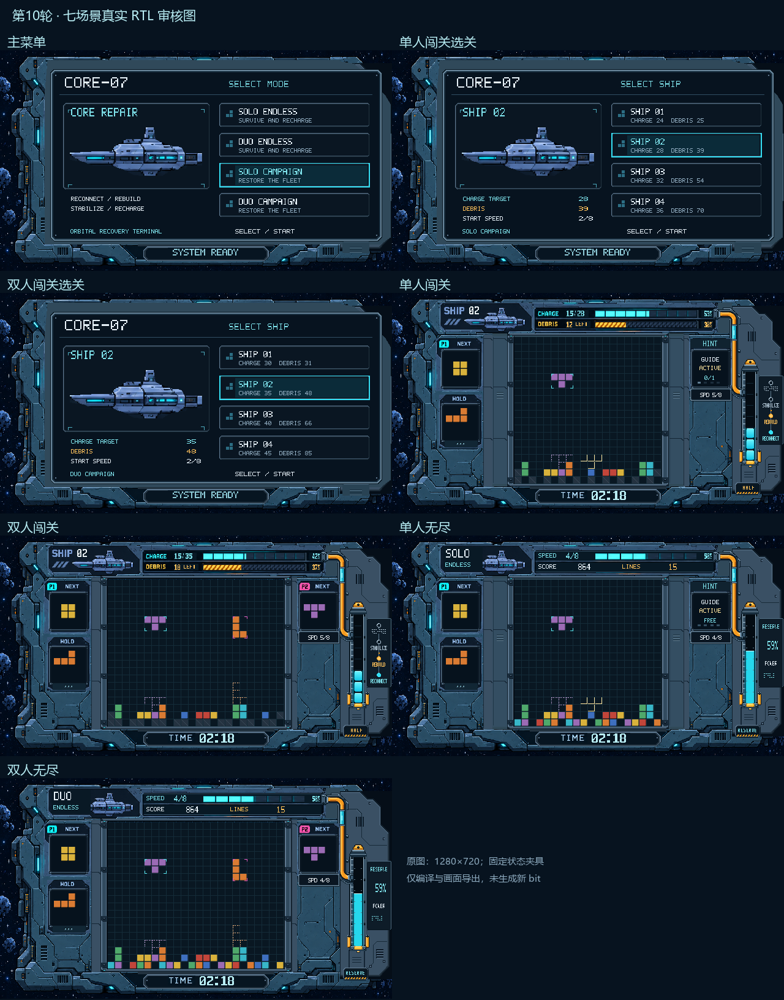

# 第10轮：七场景真实 RTL 审核图

本轮将当前机械材质扩展到四种游玩模式、主菜单与单／双人选关，实际修改 `reference_ui_renderer.v`、`story_ui.v` 和材质生成器，并通过 `ui_scenes_tb.v` 驱动正式 UI 模块输出 RGB。所有原图1280×720；总览仅是七张原图的带标题拼图，不是图生图或上板照片。

- [主菜单](20261027_主菜单_RTL.png)
- [单人闯关选关](20261027_单人闯关选关_RTL.png)
- [双人闯关选关](20261027_双人闯关选关_RTL.png)
- [单人闯关](20261027_单人闯关_RTL.png)
- [双人闯关](20261027_双人闯关_RTL.png)
- [单人无尽](20261027_单人无尽_RTL.png)
- [双人无尽](20261027_双人无尽_RTL.png)

实现范围：

- 单人场地20×20，双人24×20，单格均24px；沿用已细化的船壳、边框、导管接口和八段核心。
- 单人显示智能落点与对应HINT状态；双人保留P2 NEXT并隐藏智能落点。单人无尽显示FREE，单人闯关读取剩余额度／上限。
- 闯关显示SHIP、CHARGE真实记功／对应人数目标、DEBRIS剩余、SPD与TIME；两张样例选SHIP02并采用有效的HALF状态。单人12/39残骸、目标28；双人18/48残骸、目标35。15点记功对应SPD5/8。
- 无尽显示SCORE、LINES、TIME和顶部八段速度条，右柱RESERVE连续填充；样例02:18对应SPD4/8，不显示残骸任务或修复阶段。
- 主菜单同时展示四种真实模式并按choose_cnt高亮；选关展示四艘船，目标与残骸数直接读取 `game_mode_params.vh` 对应单／双人参数，不添加虚构锁定或记录。
- 菜单与选关采用统一终端视口与飞船预览，底部SYSTEM READY替代游玩计时。

只读现有游戏状态，核心状态机、场地、计分、闯关控制器、储备、HOLD和提示预算逻辑均未修改。源码、素材、测试台及每张帧指纹见 `manifest.json`。无尽速度条改为八格、单人落点夹具修正后，仅重导出单人闯关与单／双人无尽三张；其余四张不受影响，复用首轮输出。首轮实际源码指纹及快照分别记录于manifest与input_snapshots。

本轮只运行编译、展开与七张固定状态画面导出，未做功能复验、综合、布局布线或生成新bit。正式bit仍为改动前版本，结果供用户逐图审核。
