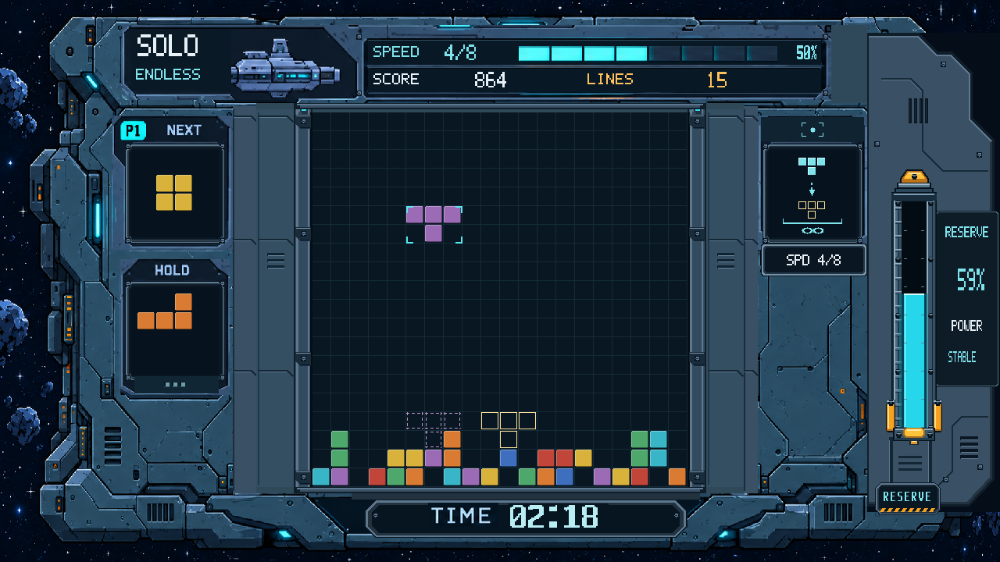

# 第11轮：图形智能落点与无尽去导管

红圈位置原本是单人智能落点状态面板。本轮按用户要求改为完全图形展示，且仅移除无尽模式的导管；闯关保留充能路径。

- 单人面板：去除HINT、GUIDE、ACTIVE、FREE和额度数字；上方使用定位图标，窗口内用当前 `hint_type` 的实心方块、下落箭头、同形空心目标与落地底边表达落点。亮暗读取 `hint_active`。
- 单人闯关：小格读取真实额度与容量，可用实心、已消耗空心、未开放降暗；下沿短条读取 `hint_life`。场地内的智能落点投影继续保留。
- 单人无尽：底部为几何绘制的无限符号，不显示文字或虚假次数。
- 单／双人无尽：连同槽沿、固定支座、玻璃卡箍、首尾接套一起移除导管，通过精确差分遮罩恢复船壳、面板和核心侧轨的原始底层材质。
- 单人闯关保留导管；双人闯关、主菜单与两种选关未改，仍见上一轮。

- [单人闯关](20261027_单人闯关_RTL.png)
- [双人无尽](20261027_双人无尽_RTL.png)
- [上一轮全部界面](../20261027_UI迭代第10轮_全模式/README.md)

三张图均为实际 `story_ui.v`、`reference_ui_renderer.v` 经XSim2018.3编译、展开与单帧RGB导出，原图1280×720，附2倍原像素图。固定状态沿用第10轮，不是上板照片。

与第10轮逐像素核对，变化仅限提示面板与无尽导管组件范围；游戏核心文件与基线46745c1无差异。源码、素材和帧指纹见manifest.json。仅编译和画面导出，未跑功能复验、综合或布线，正式bit未变，等待审核。
