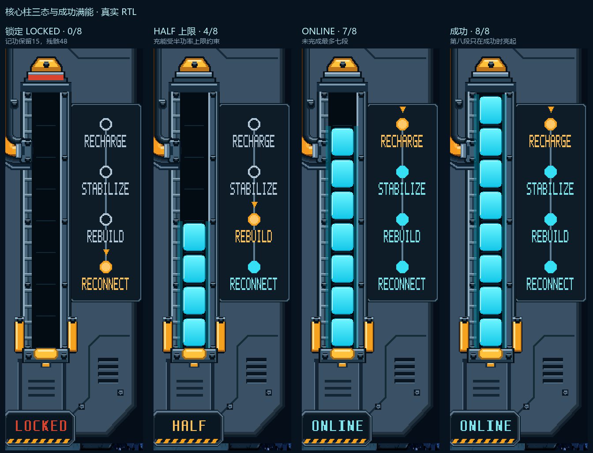

# 第12轮：P2凸出结构与组件多状态 RTL

P2 NEXT上沿直接沿用P1的同一轮廓，两侧相对于预览槽的偏移相同；保持品红P2字样。单人图形提示面板沿用原上沿，防止出现P2残影。

- [双人闯关](20261027_双人闯关_RTL.png)
- [双人无尽](20261027_双人无尽_RTL.png)
- [P1/P2凸出结构对照](20261027_P1P2凸出结构_RTL对照.png)

## 组件状态

- [核心柱 · 八状态](20261027_核心柱_八状态_RTL.png)
- [储备柱 · 五状态](20261027_储备柱_五状态_RTL.png)
- [智能落点 · 七状态](20261027_智能落点_七状态_RTL.png)
- [HOLD · 八状态](20261027_HOLD_八状态_RTL.png)
- [无尽速度 · 八档](20261027_无尽速度_八档_RTL.png)
- [船况任务 · 五状态](20261027_船况任务_五状态_RTL.png)

共2张1280×720整图和41张原坐标组件帧。组件图由正式story_ui实例读取各状态输入后直接扫描原位置，不是把旧图改色；原始PNG保存在“原始状态帧”，对照表仅作整数倍放大并在外侧添加中文标签。

核心覆盖LOCKED零段、HALF刚解锁／3／4段、ONLINE5／7段、成功8段及高光帧，四阶段随可见段数高亮；储备覆盖满／正常／预警／危急／耗尽；提示覆盖闯关启用、关闭、余量、扩容与无尽开关；HOLD覆盖空槽、受限、有块、P1/P2预约、到期与拒绝；另有速度八档及船况任务五态。

本轮状态展示同时修整LOCKED红色锁带居中、储备告警读数颜色、已完成任务的划线。全部只改视觉与状态输入夹具；单独成功核心是移除结果遮挡前的组件展示，不等于完整游戏状态机演进验证。

实际XSim2018.3编译、展开、RGB导出，源文件、素材、测试台、输入区域和每张帧指纹见manifest.json。整图除P2上沿范围外与前轮一致。游戏核心文件与基线46745c1无差异，正式bit未变；未做功能复验、综合或布线。等待用户审核。
