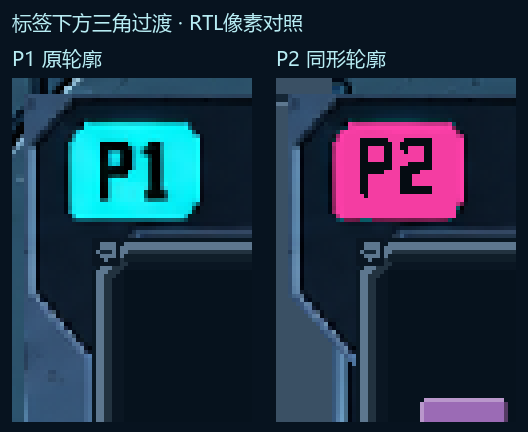

# 第13轮：P2标签下方三角过渡

上一轮只复制P1到y=184的上沿，未覆盖标签下面的斜三角肩部，导致P2在此处仍为直边。本轮把P1原斜面(143,184)–(168,216)按816px相同偏移复制到P2，连接到预览框原竖边；使用原像素材质与斜面遮罩，不重画标签字形或改变预览槽。

- [双人闯关](20261027_双人闯关_RTL.png)
- [双人无尽](20261027_双人无尽_RTL.png)
- [上一轮六组组件状态](../20261027_UI迭代第12轮_P2凸出与组件状态/README.md)

两张均由实际story_ui/reference_ui_renderer经XSim2018.3编译、展开和固定状态RGB导出，1280×720。放大对照仅为同帧原坐标裁切与4倍整数放大。与前轮逐像素比较，变化只在P2标签下面的三角区域；单人及菜单材质字节一致，六组状态组件不受影响，直接复用。

源文件、素材、输入夹具及帧指纹见manifest.json。游戏核心文件和正式bit未变；仅编译、出图，未跑功能复验、综合或布线。等待用户审核。
