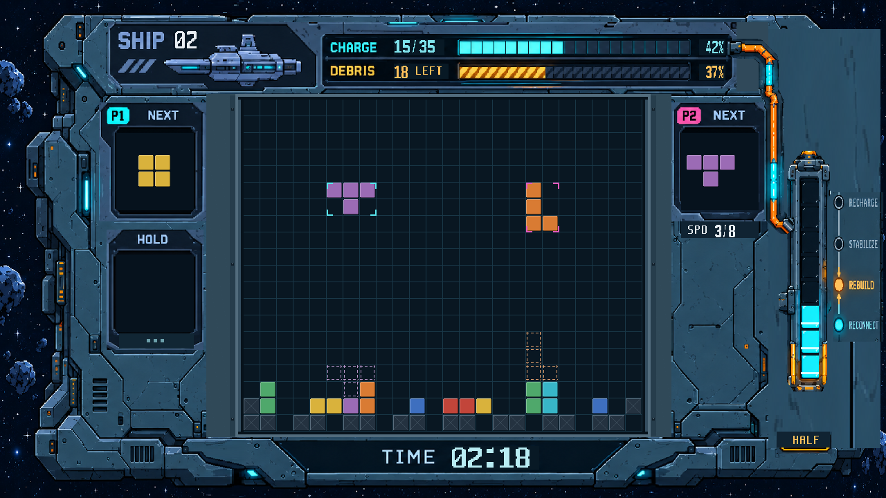

# 双人闯关 UI 第4轮 RTL 审核图

本轮按上板图恢复原有方块与残骸样式：从 `story_palette.vh` 读取七类方块原配色，按原 `block_index` 还原平面色块、一像素上/左亮边与下/右暗边、四角缺口。残骸按原 `story_ui.v` 渲染规则恢复灰蓝底色、上/左亮边和细 X 交叉线。场地、NEXT、HOLD 共用恢复后的方块材质。

修整用户圈出的场地两侧：去除横向拉宽的边框碎片和左下残留橙色效果，整理为连续的内嵌槽、金属边沿及少量固定点。保持场地 (352,144)、576×480、24×20 单元与其余重点模块位置。

[2倍原像素图](20261027_双人闯关_HALF_RTL_2倍.png) · [方块、残骸与接缝局部2倍图](20261027_方块残骸与接缝_局部2倍_RTL.png)

图片由实际 `story_ui.v`、`reference_ui_renderer.v` 和材质数据经 Vivado XSim 2018.3 导出。固定场景为 SHIP02、CHARGE15/35、残骸18、HALF三段、REBUILD、TIME02:18；不是上板照片或生成式效果图。源码、素材及帧指纹见 `manifest.json`。

仅运行编译、展开和单帧导出；未做功能复验、综合、布线或生成新 bit。游戏核心文件与基线 `46745c1` 无差异；正式 bit 未变。出图后等待用户审核。
