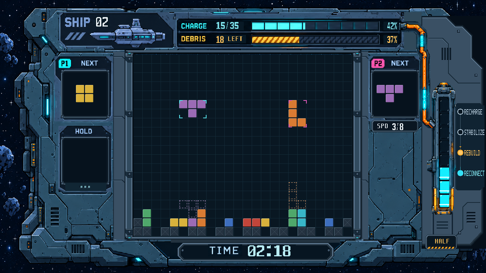

# 双人闯关 UI 第5轮 RTL 审核图

根据用户提供的 `art_review/fig3_fix_prompts.md` 与 `fig3_zone_map.png` 修改渲染代码和静态素材，再由 Vivado XSim 2018.3 编译、展开并输出真实 RGB 帧。不是图生图或上板照片。

本轮采用：

- ② 仪表台：加强深色轨槽与边唇，CHARGE 使用十格分段；数据仍由现有状态计算。
- ③⑤ NEXT／HOLD／SPD：双层斜切、内侧暗边、四角小固定件；空 HOLD 及三格保持低对比。
- ④ 场地内框：24px 金属边框，三档硬边明暗、接缝、转角青色刻线和固定件；网格线压暗。
- ⑥ 右侧：移除非等比拉伸的大补片，补连续切角机壳、散热槽和固定点；保留图一原管道、沟道、套口及核心壳体。刻度使用专用5×7像素字母，文字、圆环和连接线由 RTL 读取当前阶段绘制，顺序由下向上。
- ⑦ 时间牌：独立倒角深色铭牌，与棋盘留出间隙；TIME 标签和计时位置保持。

保留已确认工程约束：24×20 场地、原位单格24px、八段核心、原版平面方块与细 X 残骸、原百分比计算规则。未套用提示词中的 10×20、六段核心、固定43%／38%及整体缩小要求；未改变功能区锚点。

[2倍原像素图](20261027_双人闯关_HALF_RTL_2倍.png) · [导管、核心与刻度局部2倍图](20261027_导管核心刻度_局部2倍_RTL.png)

固定状态：SHIP02、CHARGE15/35、残骸18、HALF三段、REBUILD、TIME02:18。源码、素材、提示词和输出帧指纹见 `manifest.json`。

本轮只运行编译、展开和单帧导出，没有功能复验、综合、布线或新 bit。游戏核心文件与基线 `46745c1` 无差异，正式 bit 未变。待用户审核后继续。
