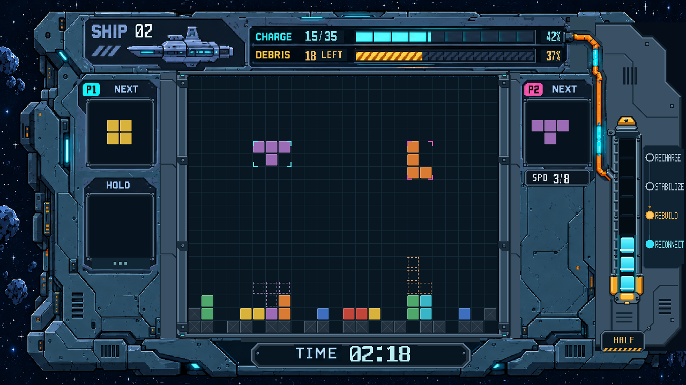

# 双人闯关 UI 第6轮 RTL 审核图

本轮只改能量柱。用户确认保留八段动态显示，琥珀色作为机械底座，主要重做外壳。位置、高度及相对面板宽度沿用第5轮，核心玻璃坐标和充能状态输入不变。

- 外壳：三层切角金属、内嵌暗槽、左侧梯状横档、右侧直条加工导轨、接缝六角螺栓及硬边高光。
- 顶部：橙金穹顶、暗色六角螺栓、阶梯套环、左侧支耳。
- 内舱：未充能位置保留近黑底与微弱分隔线；八段按真实状态显示，已亮电芯使用青色渐变、切圆角、内缘高光，并向附近导轨投射局部青光。
- 底部：双侧厚橙夹块、带螺栓底板、独立琥珀机械端盖和短橙管接头。

[能量柱4倍原像素局部](20261027_能量柱_局部4倍_RTL.png) · [整图2倍](20261027_双人闯关_HALF_RTL_2倍.png)

画面由实际 `story_ui.v` 和 `reference_ui_renderer.v` 经 XSim 2018.3 编译、展开和固定状态单帧导出。与第5轮逐像素核对，能量柱范围 (1124,214)–(1204,570) 外完全一致。保留 SHIP02、15/35、残骸18、HALF三段、REBUILD、02:18；不是上板照片。

源码、素材与帧指纹见 `manifest.json`。游戏核心文件与基线 `46745c1` 无差异，正式 bit 未变；本轮未跑功能复验、综合或布线。等待用户审核。
