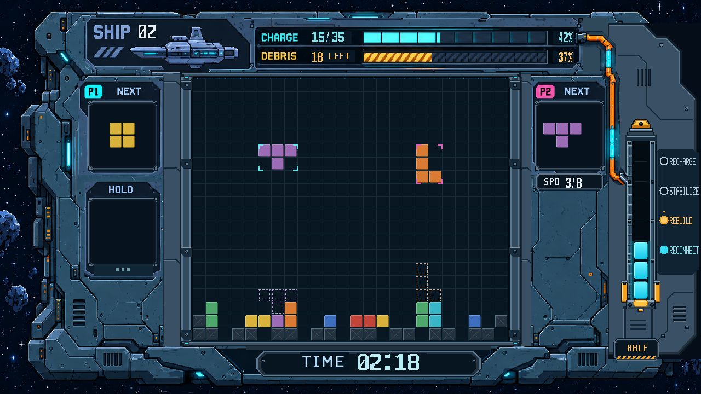

# 双人闯关 UI 第7轮 RTL 审核图

遵循本轮“一次只改一个区”：仅处理①核心柱，读取 `art_review/warp_map.png` 与 `art_review/ref_core_target.png`。图例、橙管及 SPD 延后，未在本轮叠改。沿用用户确认的八段动态显示，琥珀色仍为机械底座。

采用统一几何坐标：

- 中心轴 x=1170；冠顶、方肩套环、矩形舱、底板与短接头沿此轴定位。
- 主外框 x=1141..1199；舱体 x=1154..1186，方角矩形凹槽；侧轨竖直平行。
- 左侧横档18px等距；成对螺栓 y=260/332/404/476/548，72px等距。
- 左右橙夹块等宽、同高，统一从 y=512 开始。清除旧顶部支耳与重复短边。
- 八段电芯继续读取原 locked 状态，每段36px；每个亮面由RTL直接绘制26×32px及4px圆角，左右距舱壁各3px。保留青色渐变和内缘细亮线；充能高光限制在上缘，去除横穿电芯底部的白亮条。

[核心柱4倍细节](20261027_核心柱对轴_局部4倍_RTL.png) · [整图2倍](20261027_双人闯关_HALF_RTL_2倍.png)

图片由实际 `story_ui.v`、`reference_ui_renderer.v` 经 XSim 2018.3 编译、展开和单帧导出。固定场景仍为 SHIP02、15/35、残骸18、HALF三段、REBUILD、02:18。

核心柱完整修复范围为 (1124,208)–(1206,578)，左边包含旧支耳轮廓。范围外像素与第6轮完全一致。源码、素材、参考图与输出帧指纹见 `manifest.json`。

游戏核心文件与基线 `46745c1` 无差异，正式 bit 未变。本轮没有功能复验、综合或布线，等待用户审核。
