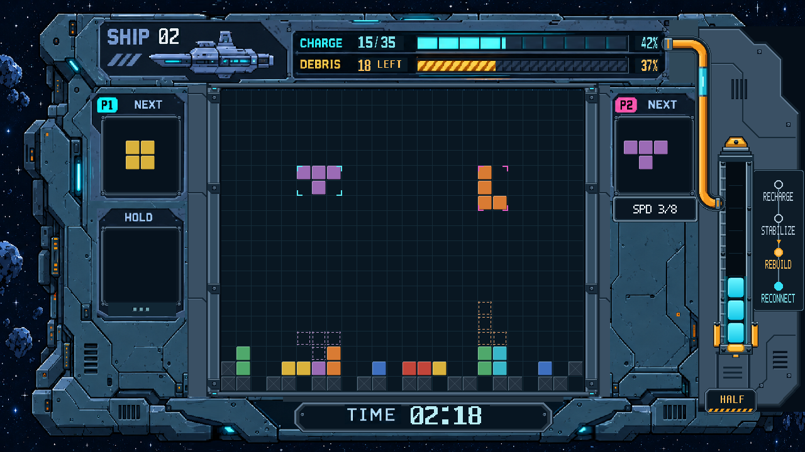

# 双人闯关 UI 第8轮 RTL 审核图

用户要求将剩余区域全部改完。本轮完成②图例、③管道、④SPD，①核心柱沿用第7轮。针对窄列空间，用户确认“图例改为圆环在上、名称在下，保持当前位置和完整文字”。

- 图例：四个14px圆环同轴、54px等距；下方阶段名称使用与SPD相同的5×7像素字母、14px字高，完整置于面板内。名称区留白至少12px。当前阶段橙色高亮、上方箭头向下，过去阶段实心青色、未来空心。2px纵向连接线在名称底板后方，以免穿过字形。
- 管道：统一14px管径；两个90度弯头均为20px半径；沟道、暗边、管体分别成层，单段直立青色液管与主管共轴；亮芯限于液管中间三分之一，最高RGB194/249/252；首尾套口水平对轴，去除捏细接头、45度斜短管及重复外轮廓。
- SPD：铭牌仅2px切角；全部字符由同一个像素字母表绘制，`SPD 3/8`只有一条斜杠、字距一致、基线水平，最小内边距12px。

[整图2倍](20261027_双人闯关_HALF_RTL_2倍.png) · [右侧三区局部2倍](20261027_右侧三区_局部2倍_RTL.png)

实际 `story_ui.v`、`reference_ui_renderer.v` 经 XSim 2018.3 编译、展开并导出RGB帧。固定场景仍为 SHIP02、15/35、残骸18、HALF三段、REBUILD、02:18。管道、图例、SPD修复范围外的像素与第7轮完全一致；管道末端只更新核心侧接套，核心舱体及电芯未重排。

源码、素材、几何参数和帧指纹见 `manifest.json`。游戏核心文件与基线 `46745c1` 无差异，正式bit未变。本轮未做功能复验、综合或布线；画面供用户审核。
