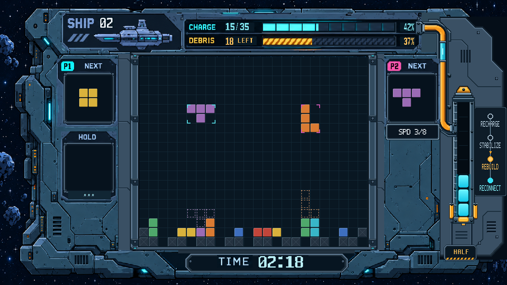

# 双人闯关 UI 第9轮 RTL 审核图

按用户要求对照 `assets/reference_ui/source_core_pipe.png`，仅优化沟道、导管与其他硬件的衔接。核心柱主体、图例、文字数据及其余画面沿用第8轮。

- 船况头出口：法兰接入船况头右端框体，与CHARGE轨同高；补成对螺栓、凹入式管口、密封层和短套筒。
- 沟道与弯头：管道半径仍为7px、两个弯头半径仍20px；沟道采样半径15px，增加暗槽、两级槽沿及与船壳相接的肩板。
- 与P2/NEXT及SPD相邻处：完整保留面板右侧加工边，让它成为沟道左壁，消除沟道覆盖面板外框的交叠。
- 青色玻璃管：两端增加水平套环，槽沿旁增加固定船壳的小支座。
- 核心入口：固定承座接入核心左轨，成对螺栓、管口、套筒共用 y=324 接入轴线，接口限制在舱体外侧。

[沟道及接口4倍细节](20261027_沟道导管衔接_局部4倍_RTL.png) · [整图2倍](20261027_双人闯关_HALF_RTL_2倍.png)

图片由实际 `story_ui.v`、`reference_ui_renderer.v` 与本轮素材经 XSim 2018.3 编译、展开并导出固定状态RGB帧。状态仍为SHIP02、15/35、残骸18、HALF三段、REBUILD、02:18；不是上板照片。

与第8轮逐像素比较，范围 (1048,46)–(1157,354) 外完全一致。源码、素材与帧指纹见 `manifest.json`。游戏核心文件与基线 `46745c1` 无差异，正式bit未变。本轮没有功能复验、综合或布线，待用户审核。
