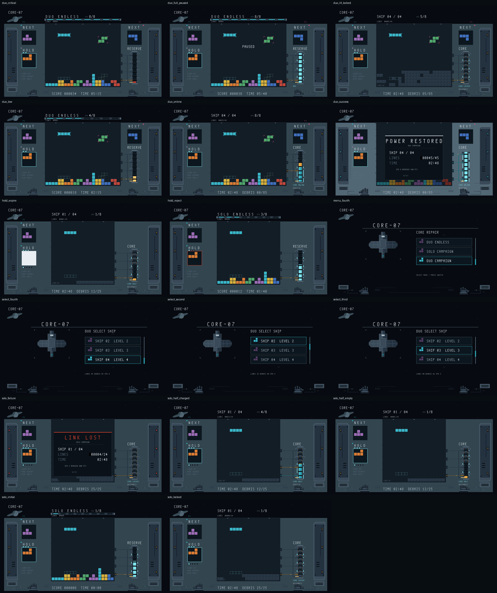

# 预览图清单

更新：2026-10-29。预览图只记录实际画面，不是设计目标；不得用预览图替代 `最新参考图/`。来源分“上板拍摄”和“RTL生成”，不混放。

## 当前登记

### 2026-10-29 导管、背景与船板细化

- [38帧当前RTL图](RTL生成/20261029_导管背景与船板细化/README.md)：修复导管玻璃接头与橙管高光的残片，外围补静态流星和两颗小行星，船板补连续接缝和嵌入通风槽。
- [最终报告](../../reports/ui_polish_20261029/README.md)：19135 LUT、剩余1665，49.5 BRAM；WNS +0.063ns、WHS +0.036ns，TNS/THS为0。15组功能、8组组件及38帧RTL通过；旧bit归档，PC沿用原版，实机待用户核对。

### 2026-10-29 UI布局、选关与背景修正

- [38帧当前RTL图](RTL生成/20261029_UI布局与背景修正/README.md)：四种游玩、主菜单、四项选关高亮、核心与阶段状态、暂停／结算／七段对白及双人右上对白整图。
- [最终报告](../../reports/ui_layout_20261029/README.md)：19031 LUT，剩余1769；49.5 BRAM，WNS +0.059ns、WHS +0.079ns，TNS/THS为0。旧bit归档，PC沿用原版，实机待用户核对。
- 本轮新增蓝色像素行星、修复缺失槽壁、透明合成面板四角，核心与飞船主体保留原生像素；原参考素材未覆盖。

### 2026-10-29 新UI最终硬件实现

- [七场景及20个局部状态，共27帧原尺寸RTL](RTL生成/20261028_新UI_最终硬件实现/README.md)：四种游玩、主菜单、两种选关、核心四态、暂停、三种结算、七条对白、第四船滚动窗口、储备危急明暗、回充MAX边界。
- [最终交付报告](../../reports/new_ui_final_20261028/README.md)：18298 LUT、剩余2502、50 BRAM；WNS +0.445ns、WHS +0.036ns、TNS/THS为0。源码／材质／工程指纹与正式bit绑定。
- 保留重点模块，外围D1/D2/D3简化；没有削减动态。原参考图不变，实机呈现待用户验证。下面A1/A2/A3及逐轮记录均为历史阶段状态。

### 2026-10-28 新UI A3重点模块接入

- [四模式、核心／刻度／储备多状态及接缝RTL](RTL生成/20261028_新UI_A3_重点模块接入/README.md)：21帧、5776228像素，与独立A2同输入对照零差异；核心索引仅整数放大。
- [独立资源与时序估计](../../reports/new_ui_a3_20261028/README.md)：重点模块含材质936 LUT／31.5 BRAM；建立时间估计WNS+0.389ns，保持时间仍有负值，未布线，不能视为整机通过。
- 冻结参考、游戏核心及正式bit不变；未裁装饰或动态，待本轮审核。剩余预览ROM、网口扩色、整机800 LUT余量及最终布线尚未完成。

### 2026-10-28 新UI A2公共层接入

- [七场景与九局部状态RTL](RTL生成/20261028_新UI_A2_公共层接入/README.md)：最终公共层与字库已接入，与A2前同输入、同近色材质对照6751856像素零差异。
- [独立综合与接口时序估计](../../reports/new_ui_a2_20261028/README.md)：基础层1184 LUT／8 BRAM，文本481 LUT／0 BRAM；整机800 LUT余量尚未确认。
- 未删装饰或动态，未生成bit，等待本轮审核；原参考图保持不变。

### 2026-10-28 新UI A1首轮

- [近色整图与材质ROM原型](RTL生成/20261028_新UI_A1_近色与材质原型/README.md)。
- 两张合色整图、四张独立材质RTL帧与对照；原56色保留，静态材质试编1437色，阈值ΔE76≤3，未砍装饰或动态。
- [独立综合与验证报告](../../reports/new_ui_a1_20261028/README.md)：新原型尚未整机接入，800 LUT余量待整机确认，未生成bit，等待审核。

### 2026-10-27 UI 第14轮审核图

- [统一文字、左侧信息栏、LOCKED铁索、左上对白](RTL生成/20261027_UI迭代第14轮_统一文字与左侧信息栏/README.md)。
- 7种场景、带对白整图、4种核心柱与7种对白状态，共20张真实RTL原始帧。仅编译与画面导出，等待审核。

### 2026-10-27 UI 第13轮审核图

- [P2标签下方三角过渡与整图](RTL生成/20261027_UI迭代第13轮_P2三角过渡/README.md)。
- 补齐与P1相同的斜三角肩部，仅该区域像素变化；单人、菜单及上轮组件状态不变，等待审核。

### 2026-10-27 UI 第12轮审核图

- [P2同形凸出与组件状态入口](RTL生成/20261027_UI迭代第12轮_P2凸出与组件状态/README.md)。
- 2张双人整图、41张独立RTL组件帧；核心、储备、智能落点、HOLD、速度和船况任务共六组状态，等待审核。

### 2026-10-27 UI 第11轮审核图

- [单人无尽 / 图形智能落点、移除导管](RTL生成/20261027_UI迭代第11轮_图形提示与无尽去管/20261027_单人无尽_RTL.png)，[三张原图与说明](RTL生成/20261027_UI迭代第11轮_图形提示与无尽去管/README.md)。
- 单人提示面板去文字，闯关显示额度图格、无尽显示无限符号；单/双人无尽去除导管及沟道，闯关保留。等待审核。

### 2026-10-27 UI 第10轮七场景审核图

- [七场景真实RTL总览](RTL生成/20261027_UI迭代第10轮_全模式/20261027_七场景_RTL总览.png)，[原图与范围说明](RTL生成/20261027_UI迭代第10轮_全模式/README.md)。
- 包含主菜单、单／双人选关、单／双人闯关、单／双人无尽；读取实际游戏状态与模式参数，等待用户审核。

### 2026-10-27 UI 第9轮审核图

- [双人闯关 HALF / 第9轮真实RTL图](RTL生成/20261027_UI迭代第9轮/20261027_双人闯关_HALF_RTL.png)，[沟道与导管接口说明](RTL生成/20261027_UI迭代第9轮/README.md)。
- 船况头法兰、沟道肩板、面板共用槽壁、玻璃管卡箍及核心入口承座细化；范围外像素与第8轮一致，等待审核。

### 2026-10-27 UI 第8轮审核图

- [双人闯关 HALF / 第8轮真实RTL图](RTL生成/20261027_UI迭代第8轮/20261027_双人闯关_HALF_RTL.png)，[剩余三区修复说明](RTL生成/20261027_UI迭代第8轮/README.md)。
- 完成上下排图例、统一管径与圆弯头、SPD像素字重排；核心柱沿用第7轮。三区范围外像素与第7轮一致，等待审核。

### 2026-10-27 UI 第7轮审核图

- [双人闯关 HALF / 第7轮真实RTL图](RTL生成/20261027_UI迭代第7轮/20261027_双人闯关_HALF_RTL.png)，[核心柱对轴修复说明](RTL生成/20261027_UI迭代第7轮/README.md)。
- 只处理①核心柱：统一轴线、矩形舱、平行轨、等距横档与螺栓、同高夹块及4px圆角电芯；范围外像素与第6轮一致，等待审核。

### 2026-10-27 UI 第6轮审核图

- [双人闯关 HALF / 第6轮真实RTL图](RTL生成/20261027_UI迭代第6轮/20261027_双人闯关_HALF_RTL.png)，[能量柱单区改动说明](RTL生成/20261027_UI迭代第6轮/README.md)。
- 只改能量柱：三层外壳、左右不对称导轨、冠顶套环、夹块和机械琥珀底座；保留八段动态。范围外像素与第5轮完全一致，等待审核。

### 2026-10-27 UI 第5轮审核图

- [双人闯关 HALF / 第5轮真实RTL图](RTL生成/20261027_UI迭代第5轮/20261027_双人闯关_HALF_RTL.png)，[提示词落实范围](RTL生成/20261027_UI迭代第5轮/README.md)。
- 按审图分区细化厚边框、凹槽、右侧机壳、导管衔接、动态刻度与独立时间牌；保留24×20场地、八段核心、原版方块和残骸。等待用户审核。

### 2026-10-27 UI 第4轮审核图

- [双人闯关 HALF / 第4轮真实RTL图](RTL生成/20261027_UI迭代第4轮/20261027_双人闯关_HALF_RTL.png)，[方块、残骸与边框改动说明](RTL生成/20261027_UI迭代第4轮/README.md)。
- 恢复上板图的原有平面方块和残骸细 X 纹，修整场地两侧连续接缝。固定场景的当前RTL输出，等待用户审核。

### 2026-10-27 UI 第3轮审核图

- [双人闯关 HALF / 第3轮真实RTL图](RTL生成/20261027_UI迭代第3轮/20261027_双人闯关_HALF_RTL.png)，[导管沟道改动说明](RTL生成/20261027_UI迭代第3轮/README.md)。
- 按“导管有沟道”的反馈保留原参考的凹槽、暗边和金属槽沿；其他模块保持第2轮。固定场景的当前RTL输出，等待用户审核。

### 2026-10-27 UI 第2轮审核图

- [双人闯关 HALF / 第2轮真实RTL图](RTL生成/20261027_UI迭代第2轮/20261027_双人闯关_HALF_RTL.png)，[取材与改动说明](RTL生成/20261027_UI迭代第2轮/README.md)。
- 图一的管道/核心/刻度、图二的船况头/NEXT/HOLD；重点修正CHARGE右端套口与管道入口。固定场景的当前RTL输出，等待用户审核。

### 2026-10-27 UI 第1轮审核图

- [双人闯关 HALF / 真实RTL图](RTL生成/20261027_UI迭代第1轮/20261027_双人闯关_HALF_RTL.png)，[来源和范围](RTL生成/20261027_UI迭代第1轮/README.md)。
- 由当前 `story_ui.v`、`reference_ui_renderer.v` 和实际初始化数据经 XSim 输出RGB，使用固定UI状态夹具，不是生成式效果图，也不是上板照片。
- 输入指纹、基线提交和测试台见同目录 `manifest.json`。本轮不生成bit、不复验或总检测；画面等待用户审核。

### 2026-10-26 四模式 RTL 预览

- 来源：`docs/reports/story_rhythm_20261026_final/previews/`
- 类型：真实 RTL 固定夹具渲染，不是上板拍摄（`preview-manifest.json` 标记 `real_rtl_fixed_fixture_not_hardware_capture`）
- 对应发布 bit：`446726a44cfa92830ccf00cef2cf6653e280513e15de37a1882335cdd414ef89`（README 所列）
- 本地副本：`RTL生成/20261026_四模式/`（17 张场景 + `contact-sheet.png` + `manifest.json`）；报告目录保留证据原件。

| 分组 | 文件 |
| --- | --- |
| 主菜单 | [menu_fourth.png](RTL生成/20261026_四模式/menu_fourth.png) |
| 选船 | [select_second.png](RTL生成/20261026_四模式/select_second.png)、[select_third.png](RTL生成/20261026_四模式/select_third.png)、[select_fourth.png](RTL生成/20261026_四模式/select_fourth.png) |
| 单人无尽 | [solo_initial.png](RTL生成/20261026_四模式/solo_initial.png) |
| 单人闯关 | [solo_locked.png](RTL生成/20261026_四模式/solo_locked.png)、[solo_half_empty.png](RTL生成/20261026_四模式/solo_half_empty.png)、[solo_half_charged.png](RTL生成/20261026_四模式/solo_half_charged.png)、[solo_failure.png](RTL生成/20261026_四模式/solo_failure.png) |
| 双人无尽 | [duo_low.png](RTL生成/20261026_四模式/duo_low.png)、[duo_critical.png](RTL生成/20261026_四模式/duo_critical.png)、[duo_full_paused.png](RTL生成/20261026_四模式/duo_full_paused.png) |
| 双人闯关 | [duo_online.png](RTL生成/20261026_四模式/duo_online.png)、[duo_l4_locked.png](RTL生成/20261026_四模式/duo_l4_locked.png)、[duo_success.png](RTL生成/20261026_四模式/duo_success.png) |
| HOLD | [hold_reject.png](RTL生成/20261026_四模式/hold_reject.png)、[hold_expire.png](RTL生成/20261026_四模式/hold_expire.png) |

共 17 张，另有 1 张总览；覆盖主菜单、选船、单人/双人无尽、单人/双人闯关与 HOLD，不是每个模式的全部状态。本地副本与报告原件同哈希（见 `manifest.json`）；如果源码或 bit 变化，这些图在清单中改标“过期”，需要时移入 `历史/`。

## 维护方式

1. 上板拍摄：放 `上板拍摄/`，命名 `YYYYMMDD_场景_状态_板卡.png`；在清单登记 bit 版本、拍摄链路和观察结论。
2. RTL 生成：只在用户明确要求时生成；放 `RTL生成/YYYYMMDD_批次/`，附 `manifest.json`（bit SHA256 或源码指纹、测试台、场景）；在清单登记。
3. bit 更新后，旧预览标“过期”，不静默当当前；需要归档时移入 `历史/`，不删除。
4. 预览图不自动成为参考图；参考图也不证明已实现。
