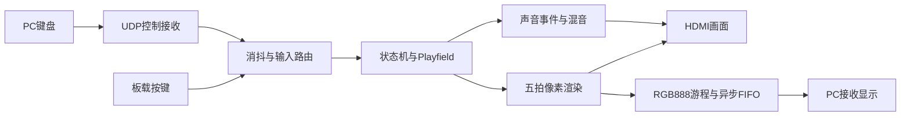

# 模块与接口导读

本文用于首次阅读代码，当前玩法与参数仍以[玩法规格](../游戏模式_玩法规格.md)为准，发布证据以[当前报告](../reports/pc_audio_20261102/README.md)为准。

## 数据流

## 主要代码入口

| 入口 | 职责 | 阅读重点 |
| --- | --- | --- |
| `Tetris.srcs/sources_1/new/Tetris.v` | 顶层连接、时钟、复位、音频与网络 | 操作来源及音频只读事件快照 |
| `control_route.v`、`net_keyboard_receiver.v` | 双玩家GPIO／PC电平合并及原子快照接收 | 半包不提交，取消不生成下落释放事件 |
| `Game_state_machine.v` | 菜单、选关、游玩、暂停及结果迁移 | 新局与退出时统一清除旧状态 |
| `frame.v` | 游戏状态与显示接口 | 真实字段和像素坐标的来源 |
| `Playfield.v` | 活动块、碰撞、落定、消行与双人事务 | 同批提交一次，消行完成后交付HOLD |
| `Playfield_hold_controller.v`、`hold_limits.v` | 暂存、预约、条件与寿命 | 暂停冻结、预约冻结与取消恢复 |
| `run_clock.v`、`reserve_timer.v`、`hint_budget.v` | 有效时间、供能与提示 | 时间单位、饱和及事务边界 |
| `story_ui.v`、`reference_ui_renderer.v` | 只读显示合成 | 五拍坐标、有效位和颜色对齐 |
| `ui_material_atlas.v`、`ui_font_5x7.v` | 材质与字形共享ROM | 同步读延迟和局部索引 |
| `Next_piece.v`、`hold_piece.v`、`spawn_shape.vh` | 预览形状小查表 | 原始坐标、零初始化及两拍延迟 |
| `voice_player.v`、`voice_adpcm_rom.v` | 语音解码与存储读取 | 九半字节打包与原样本一致性 |
| `net_screen_tx.v`、`ui_rgb_packetizer.v`、`ui_async_fifo.v` | 画面压缩与跨域发送 | 数据写完才发布描述符，异常停止发包 |
| `net_audio_packetizer.v`、`pc/pc_audio.py` | PCM分包、包级仲裁及PC播放缓冲 | 固定240样本、整包提交、会话／样本索引及安全释放系统缓冲 |
| `pc/pc_protocol.py` | 数据包编解码 | 类型、长度、游程和覆盖范围校验 |
| `pc/net_screen_view.py`（视频组帧及最新完整帧交接见 `pc/video_receiver.py`，性能验证见[PC性能报告](../reports/pc_opt_20261102/README.md)） | 接收组帧、GUI及键盘发送 | 帧号回绕、复位恢复及退出释放按键 |

上表中未写完整路径的HDL均位于 `Tetris.srcs/sources_1/new/`，以工程登记文件为准。

## 事务与时序注释

- `batch_commit` / `batch_n` 表示真实消行批次的提交与数量。显示和声音可观察它们，不能用显示动画驱动游戏判定。
- HOLD预约不在按键到来时立即交换活动块，而在落定和消行事务结束后交付，并保持NEXT不被额外消耗。
- `sample_ce`、有效游玩tick属于时钟使能，不能按新时钟域理解。
- 像素域约74.219 MHz，TMDS串行时钟约371.094 MHz，网络发送域125 MHz。跨域通信使用同步器或异步FIFO，不以任意时序例外掩盖真实路径。
- 图集与字形使用同步读。改动ROM读延迟时，需要同时检查坐标、有效标记和RGB输出拍数。

## 仿真与发布证据

`Tetris.sim/`仅存正式测试台；本机运行支持位于忽略的 `temporary/sim/`，因此仓库包含测试源码不等于提供异机一键完整回归环境。完整布线资源、时序、功能检查与输入指纹见 `docs/reports/rom_optimization_20261029/`。2026-10-31控制链路更新见[双来源双人控制](双来源双人控制.md)，原报告与预览仅证明对应历史版本。

## 第三方模块

HDMI编码与包格式引入部分hdl-util/hdmi源码，原作者声明、固定上游提交及完整许可证保存在[第三方来源](第三方来源/hdl_util_hdmi/README.md)。手写RTL在本机为GBK，Git按`.gitattributes`转换为UTF-8；第三方模块保留原编码，不能用错误编码批量改写注释。

## 当前核心与交付状态

ui_core_feedback只读观察残骸减少，按帧触发导管与柱内反馈，不回写游戏。六圈锁链读取残骸是否非零，独立于LOCKED／HALF电气状态；残骸清零才统一解除。当前bin与bit配对发布，PC 2026.11.02.3支持网络音视频。用户于2026-11-02反馈上板成功，版本绑定见[验收记录](../reports/board_acceptance_20261102/README.md)。
