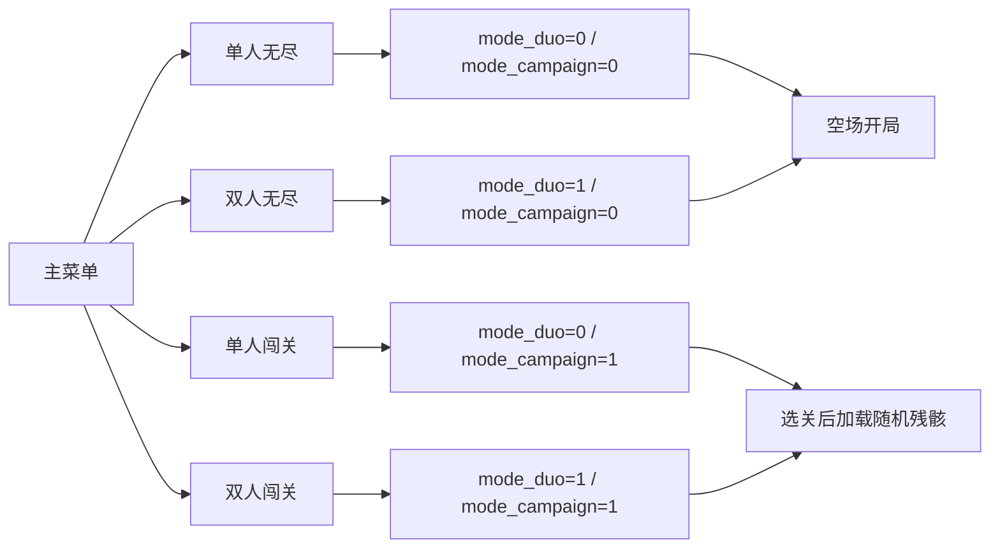

> 方案与执行资料：当前采用的玩法见 [核心玩法规格](../游戏模式_玩法规格.md)，故事见 [核心故事文件](../CORE-07_世界观与各模式故事.md)，工程规则见 [AGENTS.md](../AGENTS.md)。本文保留提议、实施步骤及当时取舍；执行采用后同步核心文件，未实施内容不表示当前已有。

# 游戏模式改动计划书（实施计划）

日期：2026-10-25；完成更新：2026-10-26。状态：四模式、残骸机制、显示与音效已实施，正式故事已同步，完整回归与整机布线通过，最新版 bit 已发布。实际采用值、证据和实机待验项见[最终实施报告](../reports/story_rhythm_20261026_final/build-summary.md)。执行前已保存本地 Git 基线；实施结果未再次提交，本次不使用 GitHub。

图例：✅已确认＝玩法要求及本轮采纳修正；⏳建议＝具体实现候选，实施时记录采用值；❓待定＝细节尚未落地。下文保留设计阶段的建议标记与分轮结构；实际已采用项及实现差异以最终实施报告为准，自动验收不代表人工上板或试听。

玩法、术语、四关数表及无尽建议参数统一见 [游戏模式_玩法规格](../游戏模式_玩法规格.md)；残骸细节见 [闯关模式详细说明](闯关模式详细说明.md)。审阅结论见 [整理记录](../整理记录/2026-10-25-游戏模式方案审阅记录.md)，不在实施正文重复过程记录。

按第 5 节唯一轮次表执行，无尽先于闯关。每轮先读取该轮任务行，再读取引用的规格和相关接口段落；不在每轮重读全部历史资料。代码实施前分别记录 Git 提交和 GitHub 推送选择；每轮按现行 AGENTS.md 只验证受影响功能，改流水线或关键路径后及时查时序；修改代码前按第 5 节完成进程检查。本文不自动新增长期工程规则。

## 1. 状态、参数与事件设计

以下接口名称是拟议名称；已有信号的实际连接以源码为准，可按现有风格命名，但必须保持数据所有权和批次语义。

### 1.1 模式与关卡配置

将“人数”和“玩法类型”分开保存，例如 `mode_duo` 与 `mode_campaign`；关卡号 `level_id` 为 0～3，界面显示 01～04。当前菜单编号不能继续直接等同于 duo 布尔值。

开局时锁存本局配置，包括模式、人数、关卡、目标行数、起始速度、升档步长、残骸参数、核心阈值，以及本局残骸种子与布局编号。菜单移动只改光标，不改正在运行或暂停的一局。无尽配置显式禁用任务胜利与残骸；不能仅把目标设为一个很大的数来模拟无尽。

✅采用生成式配置，⏳拟定源文件为 `assets/game_modes.json`，保存状态标记、八套闯关参数、两套无尽建议参数、模板规则及模板版本。所有下游常量只从此源生成，不另维护 CSV 或手填第二份表。

⏳拟新增 `tools/build_game_mode_assets.py`，与现有 `tools/build_story_assets.py` 纳入同一个构建准备入口：生成 `game_mode_params.vh`、64 套布局对应的行掩码 `story_debris.mem`、布局编号／镜像索引，以及版本和输入 SHA256 清单。资源正式路径在实施时登记，仿真派生副本与参考向量直接进入 temporary。优先按 BRAM ROM 组织掩码，实际映射及读延迟由综合确认，不承诺必然推断成某类存储。

第 1 轮建立生成链、参数模式和加载接口；第 3 轮生成并全量核对 64 套掩码，不能等场地写完才补配置源。`game_mode_config.v` 可作查表包装器，卡面、初始化和任务控制器读取同一份生成常量。新文件、ROM 初始化和生成器必须登记到正式工程、构建与仿真输入清单；构建前重新生成并核对指纹，输出不匹配即失败。

HALF 默认阈值由公式生成，第 1 关显式 `half_threshold_override` 为 13／16；断言覆盖后值没有被默认公式重算覆盖。测试期望可复用生成资源，但须另做独立逐格计数、子集可达性及规格数值锚点检查，不能用同一个错误生成器同时生成实际值和唯一验收答案。

### 1.2 页面与运行状态

| 状态／页面 | 允许操作 | 转移及约束 |
| --- | --- | --- |
| 主菜单 | 左右选择四个入口，确认 | 无尽进入开局准备；闯关进入选关 |
| 关卡选择 | 左右切换 4 张卡，确认、返回 | 确认锁存关卡；返回主菜单；本页不生成方块 |
| 开局准备 | 暂停处理游戏输入 | 清旧状态、写初始场地、等待各模块就绪，再允许生成方块 |
| 游戏中 | 当前全部游戏操作 | 暂停进入暂停态；结果确定后进入结果演出／结算 |
| 暂停 | 恢复、既有退出手势 | 恢复原局；退出取消旧局事件并回到对应入口页 |
| 结果演出 | 仅处理已支持的跳过或退出行为 | 游戏、计分和计时冻结；演出完成才展示结算 |
| 结算 | 选择并确认操作 | 无尽 RETRY／MENU；闯关 RETRY／NEXT／SELECT，按结果和关卡裁剪 |

可以保留现有 Idle 作为开局准备或待开始状态，避免为了页面命名重写全部状态机。短按、长按沿用现有输入解释；左右选项、短按确认，长按返回。长按已触发后释放不再生成短按，确认键跨页不重复触发。

结算中的 NEXT 只用于成功后的第 1～3 关，保持人数模式并加载下一关；RETRY 保持人数与关卡参数，但重新取得残骸种子，不复用上一局图案作为强制规则；SELECT 回到当前人数的选关页。无尽不存在 NEXT 或 SELECT SHIP。

### 1.3 一次开局的顺序

1. 取消旧结果、成功演出、通信及待播声音，禁止旧局事件继续生效。
2. 锁存配置，在本次开局动作被接受时取一次种子，清场地、残骸掩码、元数据、HOLD／NEXT 流程及本局统计。
3. 闯关按本局种子选定模板与镜像，等待掩码生成有效后写入残骸和相应占用位；无尽写空场。初始化期间不产生消行信用或分数。不能在持续多拍的 Idle／NEW_RUN 电平内反复取种、推进 LFSR 或换图案。
4. 装载残骸总数和核心状态，清批次暂存，设置初始速度。
5. 所有场地与元数据就绪后，才打开引擎、生成首批方块、启动计时并显示本局状态。

NEXT 随机序列沿用当前策略，不要求重开后相同。残骸也不再要求每次重开相同；复现条件改为相同人数、关卡、有效种子和模板版本生成相同掩码。暂停恢复不重新取种、不更换残骸。

### 1.4 一次消行批次的顺序

当前链路已有 `row_credit`、`batch_done`、`engine_quiescent`、`batch_n`、`batch_speed` 与 `batch_commit`。优先沿用这些事务边界，不让 UI 自行重新统计行数。

1. 消行批次开始锁存旧速度，保留 `batch_speed` 作为本批计分倍率。
2. 每删除一行，在该行掩码被覆盖前计算其残骸格数，累加本批移除数；场地、残骸掩码与已有元数据执行同一行搬移。
3. 等待动画及搬移结束，在引擎静止边界提交；本批行数、残骸差量、得分、速度、核心与结果计算使用一致的批次数据。
4. 先得到提交后的累计行数与残骸剩余，再判定核心状态和成功；一次只发一个有效提交，不把每行声音事件当成重复加分事件。
5. 若清骸且达标，锁存成功及最终成绩；若不成功，按真实顶出判失败；否则按新速度继续。

暂停撞上批次结束时保留待提交事件，恢复后提交一次；结果已经锁存后不再提交旧事件。重开或退出丢弃旧局暂存，不能把上一局最后一行带到下一局。

特别检查现有 `finish_pending`：它目前可能因达到旧目标行数而冻结引擎或抑制顶出。改为仅真实具备闯关成功资格时进入成功等待；无尽或“达标但残骸未清”的闯关不能因此卡死，也不能因此免于失败。

### 1.5 核心与储备的计算

优先用累计行数作为唯一进度来源，不另建会重复增减的“储备分数”。段数换算与状态钳位即可体现储备：锁定时隐藏已获得的进度，解除限制时恢复显示。

若采用《游戏模式_玩法规格》第 4 节建议公式，可通过比较 `8 × lines >= segment × target` 的八段阈值实现等价换算，避免把运行时除法放入关键组合路径。按一致的向上取整阈值比较，不允许因整数舍入提前点亮一段。达到目标后的大数先钳位再参与段数计算。

锁定 → ONLINE 可以发生在同一批，不能强制额外等待 HALF。若同批还成功，结果演出优先；不要依次补播已经过时的多条中间通信。

### 1.6 第 1 轮建立通用逻辑与任务接口

✅第 1 轮就分开通用批次提交、累计消行、速度计算、成绩／计时，以及模式任务的成功资格、核心段数和表现事件。`scoring.v` 保持唯一计分路径，通用速度读取生成参数；`story_controller.v` 可保留为协调外壳，按实际代码复杂度用独立子模块或清晰分区实现，不强迫拆出一套重复控制器。

无尽任务分支明确永不产生任务成功；闯关预留目标、残骸差量和核心阈值接口，第 4 轮实现完整逻辑。不得先把旧 32／40 行规则改成另一套固定无尽阈值，再到第 4 轮重做公共统计和 `finish_pending`。事件的生产者、提交者与数据快照所有权在第 1 轮确定，后续任务分支不能重计分。

### 1.7 长局接口与位宽

当前分数计数器 20 位、显示六位；累计消行 16 位、时间输出 14 位。按玩法规格的⏳建议饱和范围调整时，同步修改端口、BCD、帧快照和结果锁存，不能只扩大单个寄存器。分数加法先保留进位再钳位；残骸计数至少 7 位覆盖 85，批次残骸差量不能按单行 24 格截断；单批行数沿用 5 位并覆盖接口支持的 0～20，实际可达更大批次另做回归。

累计消行、分数及时间到显示上限仍可继续游戏，禁止自然回绕；无尽不因计数上限触发成功。闯关超目标但残骸未清同样可继续，因此不能拿目标行数直接当作最长局面或最大分数。

## 2. 残骸生成、存储与表现方案

### 2.1 参数化初始布局

每关采用 4 个基础模板及其左右镜像，共 8 个不同图案；四关 × 两种人数 × 8 图案，共 64 套。取代此前“固定布局”草案。行数、逐行块数、总数、半解锁阈值、目标和速度均来自《游戏模式_玩法规格》第 4 节及生成配置，随机仅改变空位几何。第 1 关阈值采用教学例外 13／16。

井的主位置以列宽 1/5、2/5、3/5、4/5 附近为候选，按有效列与该行空位宽度调整。不能仅把完全相同的井平移到四个左右对称位置，否则镜像可能重复；模板应在逐行缺口扩张等几何细节上作区分，并逐关逐人数检查 8 个掩码两两不同。允许单局偏向一侧，集合则须镜像配对、左右对等。

每行最少留空仍为单人 4 格、双人 5 格；贯通空列分别不少于 2／3 列；最高 5 行，向上每行块数减少 1。生成器保存参数与确定性规则，可以导出掩码表用于硬件选择，不手工维护第二套常量图。对全部 64 套逐格核对并保存掩码摘要；只检查总数不算通过。

### 2.1.1 随机取种与复现

采用 16 位右移 Galois LFSR，多项式 `x^16 + x^14 + x^13 + x^11 + 1`，反馈掩码 `0xB400`；约定一步为 `next = (seed >> 1) XOR (seed[0] ? 0xB400 : 0)`。先将零输入替换为 `0xACE1`，每局只推进一步，再取 next 的 `[1:0]` 为模板号、`[2]` 为镜像位，避免“取种前还是推进后选模板”的歧义。

选关确认时取当前帧计数低 16 位；RETRY、NEXT 及其他局内重开在相应动作被接受时同样取一次新种子。帧计数作为独立运行的取种来源，不因清旧局而复位。保留 `debris_seed` 作为非零有效输入种子，布局编号及人数、关卡一起记录，仿真可覆盖种子实现复现。新取种仍可能得到旧布局，不承诺每次图案都不同，也不要求密码学随机。

LFSR 与残骸生成仅在开局握手中工作；游戏中保持布局选择不变，消行只更新剩余掩码，不推进布局选择器。随机源不改变 NEXT／HOLD 的原有方块序列策略。

### 2.1.2 初始化实现与验收边界

拟新增 `story_debris.v` 负责模板选择、镜像、种子及初始掩码，输出 `init_valid` 或等效就绪信号。计算生成或预生成行掩码存入 BRAM／LUT 表均可，实际开销以综合为准；不把 480 位掩码必能在 1～2 个读周期内全部输出当作承诺。按实际存储宽度安排读取与写入，在全部有效后才允许生成首个方块；若复用当前游戏时钟，只做使能隔离，不声称因此不属于该时钟域。

✅参数与 64 套掩码统一由第 1.1 节生成链导出，不在 RTL 再独立实现一套与脚本不同的几何规则；RTL 只做表选择、镜像或已登记的等价加载操作。存储可为四基础模板加运行时镜像，或完整 64 套表，但自动检查对象必须是最终 64 个有效掩码。

64 套自动检查只证明几何及存储不变式，不证明全部可消。按更新后的详细说明，由用户实板试玩抽查第 1 与第 4 关各至少 2 个不同布局，记录人数、种子、布局号和拆除结果；自动回归可补充实际落块序列验证，但不作为完整可解性证明。其他关卡或布局发现问题时扩展检查。未做的实板项列为待验，不阻塞代理完成其自动验证与交付。

“连续重开 10 次出现至少 2 种图案”作为操作抽查，不作为任意玩家时序下的硬性保证；自动测试改用固定的种子集合覆盖全部 8 个布局编号，并检查同种子复现、零种子回退、总数恒定、镜像关系与 8 个图案互不相同。

### 2.2 掩码与元数据一致性

当前 `Playfield.v` 场地占用 `state` 为 480 位，残骸另用同宽掩码表示；单人有效 20 列与物理存储列的映射遵循当前引擎，禁用列不得生成残骸。不能假定单人 400 格总是物理连续排布。

- 初始化时所有残骸位必须同时置场地占用位；其余位置掩码为零。
- 玩家方块落锁只设置正常占用和元数据，不产生残骸位。
- 每次消行、行压缩、复位都对齐处理占用、残骸与已有类型／归属元数据；残骸位不得出现在空格中。
- `debris_left` 等于有效区域掩码中剩余位数；日常按已提交差量更新，仿真逐格复算校验。
- 若残骸未赋正常方块类型或归属，渲染必须先判断残骸位，避免误读未初始化颜色；相关元数据仍须设置为合法值。
- 暂停允许按当前引擎的安全边界保存状态，不丢半批数据；对外统计和画面不能表现为暂停时仍在推进任务。

### 2.3 残骸美术与事件

建议使用灰蓝结构块、硬边和裂纹，与七种玩家方块、幽灵、归属角标形成明确区分。`#3A4A58` 只是候选颜色，最终遵循当前调色板及对比度检查。残骸同样接受堆叠危险提示，不能在高危时变得与空格一样暗。

残骸移除播放一次消行反馈并叠加短金属声；HALF、ONLINE 使用不同强度的解锁反馈。优先级建议为结果 > ONLINE > HALF > 普通移除，受现有音频优先级管理；同批多个事件合并，避免噪声叠满或打断结果通信。

## 3. 模块修改清单与界面落地

所有源码路径以下均相对 `Tetris.srcs/sources_1/new/`。此表是待实施清单，不是已完成记录。

| 文件／范围 | 拟修改内容 | 重点检查 |
| --- | --- | --- |
| `Game_state_machine.v` | 四入口、选关、开局就绪、结果选项；保留短长按语义 | 不再用菜单编号直接代表人数；无跨页误确认 |
| `Tetris.v` | 传递玩法、人数、关卡与结果操作；接入模式音频语义 | 所有下游使用同一份本局配置 |
| `assets/game_modes.json`、拟新增生成器及 `game_mode_params.vh`／`story_debris.mem` | 统一生成任务参数、核心阈值、掩码与指纹；配置包装器负责查表 | 第 1 轮建链；第 3 轮完成 64 套；卡面、初始化和任务一致，测试有独立检查 |
| 拟新增 `story_debris.v` 及必要模板生成配置 | 4 模板、镜像、LFSR、有效种子、布局号、初始掩码与就绪握手 | 64 套几何合法，每关每人数 8 个不同图案；同种子复现 |
| `frame.v` | 接入配置、初始化握手、事务与残骸渲染；调整统计快照 | 现有 `new_run`、结果页重开和 Idle 复位逻辑需一并梳理 |
| `Playfield.v` 及相关场地子模块 | 预置残骸、并行掩码、差量输出、压缩一致性 | 碰撞、幽灵、HOLD 生成及双人占用均识别残骸 |
| `story_controller.v` 与通用统计／速度接口 | 第 1 轮分离公共提交与任务分支，第 4 轮接入完整闯关；按清骸且达标判成功 | 清除旧固定 32／40 行与旧 `finish_pending` 假设；不二次重构或重计分 |
| `scoring.v`、`timer.v`、`bin_to_bcd.v` 相关接口 | 共享批次计分、长局饱和与显示 | 加法进位、位宽、暂停和结果锁存 |
| `choose_menu.v`、`story_ui.v`、`game_over.v` | 按当前实际有效渲染链分工实现四入口、选关与各类结算 | 不保留重复叠画的旧菜单／旧结果字模 |
| `core_renderer.v`、`story_scene.v`、`story_feedback.v` | 接收独立段数及状态，残骸和注能反馈 | 八段亮起不再自动代表所有模式胜利 |
| `story_presentation.v` | 无尽失败、闯关成功／失败、重开取消 | 结果演出不能更改统计或二次发成功 |
| `story_comms.v`、相关音频控制 | 通信条件跟随真实模式、阶段和解锁状态 | 无尽不播任务完成；字幕对应实际发声 |
| `net_screen_tx.v`、`rgb_to_palette.v`、`tools/net_screen_view.py` 及 `tools/tetris_pc_launcher.py` | 核对新 HUD、残骸与核心动画的网络画面、调色板及接收显示；先核实协议再决定是否改代码 | 当前发送模块没有 SHIP／DEBRIS 独立输入，不默认扩协议；首版允许没有独立字段面板，但不得错值、残留旧模式或丢失应有画面 |
| `assets/story_ui.json`、必要图形／声音配置及对应生成器 | 新固定文字、残骸视觉与必要事件素材 | 共享 ROM、地址、字形、调色板一致；需要新素材时同步生成器 |
| `Tetris.xpr` 及现有工程输入登记 | 登记实际新增模块或资产 | 本地与可复现构建使用相同输入 |
| `CORE-07_世界观与各模式故事.md` | 执行本文第 4 节故事修改 | 无尽及闯关完成前后如实标记开放状态 |
| `Tetris.sim/` 与本机 `temporary/sim/` | 新增专项测试台并接入运行入口 | 测试台目录不放脚本、日志或参考向量 |

幽灵、提示与落点判断若已经依赖统一占用位，应复用场地碰撞，不另做残骸专属碰撞路径；实际是否需要改子模块由调用链检查确定。

### 3.1 页面内容与输入

主菜单按四入口顺序展示单人无尽、双人无尽、单人闯关、双人闯关。选关页先采用单行四卡布局候选，保持已有左右输入；卡内用编号、难度、残骸数和目标行数，页头标记 SOLO／DUO。若现有字体与有效区域无法清楚容纳，改为单卡聚焦加左右预览，不为挤卡片缩小到不可读字号。

选关卡使用当前人数对应的数值。第 4 关也始终可确认；卡面上的目标、DEBRIS 初始数、开局后的实际值必须逐项相同。保持当前主操作区、核心与机械船壳风格，不另起视觉体系。

游戏中两种玩法都常驻 SCORE／SPD／TIME；无尽显示累计 LINES 和 CORE ACTIVE，闯关显示 SHIP、LINES x/target、DEBRIS 与三态核心。超过目标尚未清骸时允许显示 `LINES 40/36` 等真实值，不用钳位后的假进度掩盖还在游戏的事实。

✅无尽满亮采用持续呼吸／流动，闯关成功采用短促白闪后稳定定格，和现有成功演出保持一致；不能只靠 CORE ACTIVE／POWER RESTORED 标签区分。⏳亮度与时长待视觉轮细化，并同时检查 HDMI 与 PC 镜像；两类动画都不能改变真实任务状态。

结算显示的是结果锁存时的数据，不继续读取正在变化的 live 统计。闯关失败附残骸拆除率；无尽失败不显示没有意义的残骸数。计数饱和按照《游戏模式_玩法规格》第 5 节显示，不擅自增设最高分记录。

### 3.2 故事更新的交付方式

无尽功能轮同步写入无尽故事及其进行／失败语义；闯关功能轮同步改写四船任务、残骸和供能阶段。正式故事内可以明确写“计划中／实现待验证”，在对应玩法完成后移除该标记，避免中途把计划当成已开放内容。

所有旧的“当前只有两种模式”“统一完成 32／40 行”“阶段必随速度”“所有八段全亮都触发成功”等叙述，按新模式逐项检查。保留短通信、共同成败和失败不宣告死亡的设定。

新增配音不是新玩法上线的必要条件；若复用语音无法准确表达新状态，先用真实的状态标签和设备反馈表达，不用错配语音或无声字幕框假装完成配音。

## 4. 执行时必须完成的故事修改

正式故事文件为 [CORE-07_世界观与各模式故事.md](../CORE-07_世界观与各模式故事.md)，用户所说的“故事.md”指此文件，不另建第二份故事真源。本次已实际更新该文件，描述无尽维生与四船修复的独立故事。

| 修改位置 | 要写入或调整的故事内容 |
| --- | --- |
| 主世界观 | 从单一事故任务扩展为同一 CORE-07 维护体系下的漂流维生与多船修复；区分推进故障与供能恢复。 |
| 碎片与修复 | 保留排列、消行、回收能量的解释；补充终端对残骸的拆解回收表达，区分能量碎片与初始残骸。 |
| 核心与船体 | 沿用当前模型，增加接口阻塞、半功率、完全上线与储备能量；取消所有模式统一按速度亮段的叙述。各次接入时残骸分布可以不同，但同船任务规模不变，故事不写成每次固定残骸形状。 |
| 四段修复过程 | 四阶段属于单艘船内部的修复进展，跟随核心实际恢复；四艘船是四关，速度另表处理负荷。 |
| 单人／双人无尽 | 写入漂流、持续供能、等待救援与合作维生；没有修满即通关的结局，不引入虚构倒计时或伤亡系统。 |
| 单人／双人闯关 | 用四艘船的任务替换旧固定 32／40 行的唯一任务叙述；保留舱外检修与共同成败。具体规则数表由计划文档维护，故事侧说明任务意义。 |
| 成功与失败 | 闯关成功为残骸清除且完成充能后恢复主供能；无尽只有持续维护与链路中断结算。成功标题以当前正式故事的 POWER RESTORED 为准，失败为 LINK LOST。 |
| 通信与开放状态 | 锁定、半功率、上线的通信与真实状态相符；完成并验证后再更新模式开放状态，不提前宣称已实现。 |

故事文档仍只维护世界观、设定和各模式故事，不写实现步骤、资源预算、测试记录或发布流程。实施验收必须对照实际玩法检查：核心状态、通关条件、四关身份、无尽结局及通信均与故事一致。

## 5. 分轮实施与交付条件

轮次按依赖执行，无尽先于闯关。每轮列出的检查是对应工作应证明的结果；每轮只验证受影响功能，改流水线或关键路径后及时检查时序，最后执行完整回归和整机布线，不以分轮检查替代。

| 轮次 | 实施内容 | 应交付结果及检查重点 |
| --- | --- | --- |
| 第 0 轮：实施准备 | 记录提交／推送／每轮复验三项选择；检查现存改动归属、保存并正常退出 Vivado；核查构建进程；确定 temporary 路径 | 明确输入基线；目标工程无活动构建占用；不覆盖或混入已有改动 |
| 第 1 轮：公共接口与单人无尽 | 建 JSON→常量生成链、公共批次／速度／统计与任务分支接口；无尽胜利禁用、评分、长局边界、运行态；同步无尽故事 | 输入指纹一致；预留闯关任务接口；越过旧 32 行终点且不误胜利；分数只走一条路径 |
| 第 2 轮：双人无尽 | 复用无尽规则，接入双人场地、共同分数、共享 HOLD 与结果 | 两人同时操作不重复加分；经过旧 40 行终点仍继续；人数切换无残留 |
| 第 3 轮：残骸底层 | 在已有生成链输出 64 套掩码及 ROM 输入；随机取种与复现、占用和掩码、初始化握手、消行差量与压缩 | 全量几何／去重／HALF 结构检查、种子覆盖和镜像关系通过；碰撞与掩码同步；实板抽查另列待验 |
| 第 4 轮：闯关任务 | 接入四关速度目标、三态解锁、独立段数、全程累计与终局；同步闯关故事 | 锁定期进度保留；越阈值和清零正确；达标未清骸仍可玩且可失败 |
| 第 5 轮：入口与选关 | 四入口、全部开放选关、初始化握手、结算 RETRY／NEXT／SELECT | 任意关直达；最后一关无 NEXT；跨模式返回重开无旧局残留 |
| 第 6 轮：视觉与声音整合 | 成绩、残骸、核心运行／成功动画、选关结果画面；音频通信及 PC 镜像检查 | RTL／字形／覆盖与网络画面正确；不误播成功；核对四模式入口连线图后进入最终复验 |
| 第 7 轮：最终整体复验 | 全量回归、音视频、PC 镜像与存储集成、最终综合布线、故事一致性 | 通过后发布新版 bit；保存统计、时序、生成资源指纹、入口映射及未验收项 |

### 5.1 源码修改前的进程检查

✅先检查 `vivado.exe`、`xsim.exe`、`xelab.exe`、`xvlog.exe` 等相关进程，必要时检查批处理子进程及命令行中的目标工程路径。拟采用只读查询 `Get-CimInstance Win32_Process`，按 Name 筛选并查看 ProcessId、ParentProcessId、CommandLine；判断目标工程是否仍被构建占用，不仅看进程名。

保存可保存的工程状态并正常退出 Vivado，等待相关构建正常结束，再次确认无使用该工程目录的活动进程后才能改源码。存在未保存状态或无法正常退出时先说明，不强制结束以免丢失数据。其他工程的无关进程不擅自终止；无法确认占用归属时先查清。工程根目录旧 .jou／.log 仅说明曾运行过，不是活动进程证据。本轮仅改文档，不需要关闭 Vivado。

第 5 轮之前如需进入内部测试场景，通过测试台驱动配置，不在正式产品菜单留下调试入口。中间候选均留 temporary，不覆盖 `bit/Tetris.bit`。

## 6. 验证矩阵、发布与完成标准

### 6.1 自动功能验证

| 测试范围 | 必须覆盖的边界 |
| --- | --- |
| 无尽单人／双人 | 旧 32／40 行终点、最高档前后、最高档长时间继续、八段核心不胜利、真实顶出 |
| 四关 × 单双人 × 8 图案 | 全部 64 套的初始行数、逐行块数、总数、阈值、有效列、贯通通道及集合镜像对等；每个配置内 8 图案两两不同 |
| 随机取种与复现 | 固定种子覆盖 8 个布局编号、零种子回退、一步推进语义、同种子同配置同模板版本复现、重开重新取种、暂停不换布局、多拍初始化只选择一次 |
| 残骸消除 | 不含残骸的行、部分残骸行、单行与多行、连续批次、最高残骸移除数、掩码与占用逐格一致 |
| 核心解锁 | 每关“可达剩余值集合 ∩ HALF 区间”非空；阈值+1／恰好阈值／阈值-1、清零、LOCKED 直达 ONLINE、HALF 低进度及储备释放；验证第 1 关覆盖值 13／16 |
| 目标与结果 | 清骸但未达标、达标但未清骸、清骸同批达标、目标超出、成功与顶出碰撞、失败后不再加分 |
| 批次计分 | 0／1／2／3／4 行及实际可达更大批次、各速度档、跨档旧倍率、双人只计一次、饱和边界 |
| 暂停及重开 | 批次提交前后暂停、解锁同拍暂停、结果演出中重开、长按释放、连续确认、退出后旧事件取消 |
| 模式切换 | 无尽→闯关、闯关→无尽、单人→双人→单人、关 4→关 1、重试和下一关 |
| 统计显示 | 分数／行数／时间进位与上限、帧间快照一致、结果锁存、LINES 超目标的真实显示 |
| 生成式配置与 PC 链路 | 重生成一致、输入指纹、独立规格锚点与计数校验；新 HUD／动画网络画面、调色板、模式切换后无旧值 |

HALF 检查分两层：先从每关初始各行残骸数量枚举保留行的非空子集，计算结构上可能的剩余集合 S，断言 `S ∩ [1,T]` 非空，避免只测试一个删行顺序；再对实际模板保留合法落块／消行见证，证明引擎中确实能在某次批次提交后进入 HALF。单纯强制 `debris_left` 只能测试控制器分支，不是实际可达性证明。同批清完仍可跳过 HALF，不要求每局玩家都必须见到三态。

### 6.1.1 四模式入口连线核对

第 7 轮前对照下图及运行时锁存配置逐项检查；此连线已在本轮实现并核对。为四入口各做一次确认进入、返回和重开回归，不能只看菜单文本正确。

新测试台建议分为模式流程、无尽、残骸、关卡任务和统计边界五组，放 `Tetris.sim/` 对应子目录；优先扩展现有 `story`、`frame_duo`、`optimization` 等相关测试，不用纯粹复述实现的用例代替整条行为检查。

回归入口为 `temporary/sim/run_all.bat`，先核实当时实际测试集合，再把新增测试接入；不按历史“17 套”写死本轮已通过数量。

### 6.2 真实画面与音视频集成

保留真实 RTL 输出的主菜单、单双人选关、两种无尽、闯关三态、成功和失败场景。覆盖最短／最长数字、双人 NEXT、HOLD、核心与结算选项，检查字形、覆盖优先级及路由网表中的文字有效区。由真实显示链渲染，不以静态设计图充当功能验收。

残骸下移、消除、核心跳段和结果出现时，检查画面快照与数据提交一致，无明显半帧混合。音频检查包括结果优先级、同批去重、暂停恢复、退出取消、字幕与语音同步，以及工程现有逐样本和 TMDS 链路验证。

四艘船首版可以只改编号、参数和必要的局部标记；不把四套新船体美术作为玩法完成前提。若另生成新参考图，仍须按 AGENTS.md 展示并确认后才能替换当前视觉基准。

### 6.3 最终构建与证据

遵循 [AGENTS.md](../AGENTS.md)，不设 LUT、寄存器、BRAM 或 DSP 人为额度，不沿用旧资源门禁；按真实器件适配、功能及完整布线结果验收。

所有修改结束后执行最终整机综合、布局布线及规则要求的整体复验。完整布线后必须满足 WNS ≥ 0.000 ns、WHS ≥ 0.000 ns、TNS=0、THS=0（按用户 2026-10-26 更新的规则），无新增未说明的未约束路径、严重 DRC 或组合环；不通过错误约束或降低目标时钟放行。

临时日志、预览、中间网表与候选 bit 直接写入 `temporary/game_modes_20261025/` 或实施当日对应的专属目录；正式工具标准运行留在当前工程登记目录。必要最终摘要保存至 `docs/reports/` 的本次模式改动目录，记录：

- 最终源码、资产、生成配置及构建输入指纹。
- 实际通过／失败测试、资源统计与完整布线时序指标。
- 生成 bit 的路径、SHA256 与对应输入。
- 四种模式及故事文件的一致性结论。
- 用户尚未完成的上板画面、操作手感及人工试听项目，如实标明，不冒称已经验收。

只有与最终输入一致且整体复验通过的候选才可替换 `bit/Tetris.bit`；旧版本按 AGENTS.md 归档，相同内容不重复归档。Git 提交与推送按实施前分别授权处理，不自动创建 Release；提交与远端当前版本树只保留一个 `bit/Tetris.bit`，不混入临时产物或与本次无关的既有改动。

### 6.4 本计划执行完成的判定

四入口可用；两种无尽可越过旧终点持续计分；四关全部开放且均有对应初始残骸、目标和正确结算；每关每人数 8 个不同图案、共 64 套通过几何及去重检查，随机可复现；双人协作保持共享状态；暂停、退出、重开与切换无残留；画面、声音及通信反映真实状态；正式故事文件已实际更新；最终输入对应的自动验证和布线时序均通过，并交付可追溯的最新版 bit。

量化实机验收由用户自行上板完成；报告待验项后可结束代理的实施工作，不要求等待用户完成上板才报告已完成的自动交付部分。

## 7. 节奏压力与上板反馈实施同步（2026-10-26）

本次执行《节奏压力与辅助限制计划书》，其最新规则覆盖本文此前关于无尽按消行升速、核心常亮呼吸、无独立耗能、闯关计分展示及连续井布局的旧设计。新增实现已通过最终 19 组回归、64 套真实引擎见证、17 场景预览与整机布线，正式 bit 已更新；人工上板待用户核对。

无尽每 45 秒有效时间升档，315 秒达到第 8 档，TIME 继续至 99:59；顶部八段条表示速度，右柱 RESERVE 显示 40/75 单位供能，每秒扣 1、每批回充 8+3n。零时只等待既有事务，禁止新操作续命。闯关去 SCORE 与重复顶部修复条，突出 SHIP 关卡身份，机械锁态与实际充能分开。

HOLD 每块一次，单人 3／双人 2 块且至少 2 秒冷却，共享仲裁、暂存寿命 30 秒；提示开关、保持和关闭分路，闯关额度与回充余量按新规则，无尽不限次。菜单光标和窗口分开，三项视窗越界才滚动。模板第二版允许覆盖洞，64 套保持既定任务规模并在最终限制下重做实际清除见证。

按用户本次选择，执行前已提交本地基线79eb16d，不使用GitHub、不做每轮复验；全部改动后完整回归与整机布线，按最终输入发布。其他正文保留原始设计结构，发生冲突时以本节及节奏计划为准。
